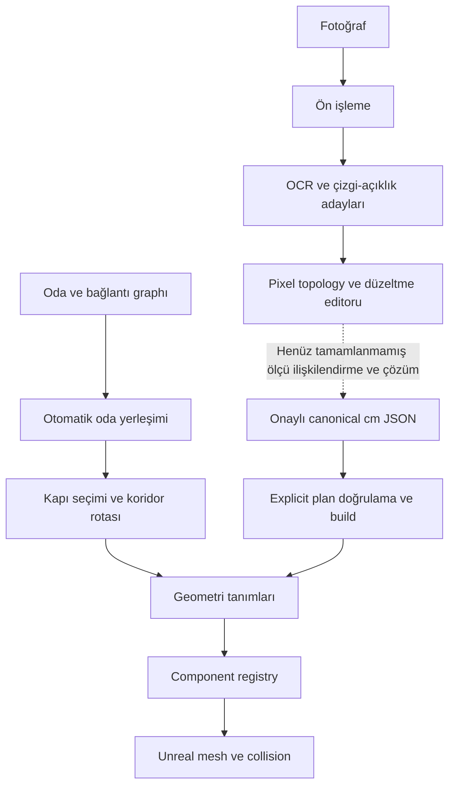

**PlayableSketch: Kodların ne yaptığı, neden böyle kurulduğu ve öğrenme sırası**

İnceleme tarihi: 16 Ekim 2026. Bu belge mevcut çalışma klasöründeki C++/Python kaynakları, testler, Git geçmişi ve aşama belgeleri birlikte değerlendirilerek hazırlanmıştır. Program kodu değiştirilmemiştir. Bu incelemede Python suite yeniden çalıştırıldı: 107 test geçti. Unreal yeniden derlenmedi; Unreal sonuçları önceki kayıtlarla sınırlıdır.

**1. Projenin ana fikri**

Hedef, kağıda çizilmiş bir planın fotoğrafından ölçülü bir Unreal ortamı üretmek. Bunun içinde birbirinden ayrı problemler var:

| Problem | Sorusu | Örnek çıktı |
| --- | --- | --- |
| Görüntü hazırlama | Fotoğrafı nasıl okuyabilirim? | Düzeltilmiş yön, gri görüntü, dönüşüm matrisi |
| Perception | Resimde ne görüyorum? | Çizgi, yazı kutusu, `600 cm`, açıklık adayı |
| Topology | Hangi sınırlar hangi bölgeleri oluşturuyor? | İki kapalı bölge, aralarında açıklık |
| Association | Hangi ölçü hangi sınıra ait? | `600 cm` → sol odanın yatay boyutu |
| Metric reconstruction | Gerçek koordinatlar ne olmalı? | Köşeler ve açıklıklar cm cinsinden |
| Generation | Bu veriyi Unreal'da nasıl kurarım? | Zemin, duvar parçaları, kapı boşluğu, collision |
| Playability | Karakter gerçekten geçebilir mi? | Agent clearance, yol, Pawn denemesi |

Şu an perception ve pixel topology/review mevcut. Onaylı ölçülü JSON'dan Unreal geometrisi üretmek de mevcut. Fakat bu iki tarafın ortasındaki genel dimension association/metric solver ve bütün ürün akışı tamamlanmış değil. Fotoğraf → otomatik doğru cm plan → oynanabilir level zinciri henüz bitmiş sayılmaz.

**2. Önce üç ayrı üretim yolunu ayır**



İlk yol **procedural graph**: “A ve B odası bağlı; odaları nereye koyacağımı ve koridoru ben hesaplayayım.”

İkinci yol **legacy import**: dar bir JSON adapter'ı, mevcut procedural modele uyabilen iki oda + düz koridor örneğini Locked konumlarla içeri alıyor. Canonical centerline ölçüleri eski clear-inside modele dönüştürüyor. Genel çizim importer'ı olarak düşünme.

Üçüncü yol **canonical explicit import**: “Duvarlar, bölgeler ve açıklıklar zaten belli; aynı planı kur.” Yeniden oda konumu bulmuyor, kapı seçmiyor, koridor rotası hesaplamıyor. Fotoğraflardaki ortak duvarları ve açık koridor girişlerini korumak için bu yol gerekli olmuş.

**3. Kodlar hangi sırayla eklenmiş?**

Git kesin olarak commit sırasını gösterir. Bir commit içindeki dosyaların hangi dakika/satır sırasıyla yazıldığını göstermez. Yeni image pipeline dosyaları henüz Git'e eklenmemiş olduğundan, onların sırası aşama belgeleri ve kod bağımlılıkları üzerinden kurulabilir. Aşağıdaki “neden” açıklamaları, belgelenen gerekçeler ve mimariden yapılan yorumlardır; yazarın özel düşüncelerinin birebir kaydı değildir.

| Sıra | Kanıt | Eklenen temel fikir | Çözdüğü ihtiyaç |
| --- | --- | --- | --- |
| 1 | 27 Eylül, `3e3d94c` | Başlangıç projesi | Unreal çalışma alanı |
| 2 | 7 Ekim, `c5810e1` | Room, Connection, GraphAsset, validator | Önce level'ın verisini tanımlamak |
| 3 | 7 Ekim, `bfa13e8` | Yerleşim, kapılar, koridor adayları, zemin ve ilk grid yolu | Mantıksal bağlantıyı fiziksel plana çevirmek |
| 4 | 7 Ekim, `81dbbcb` | Duvarlar, açıklıklar, collision | Zemin planından 3D sınırlar üretmek |
| 5 | 11 Ekim, `024fae0` | Saved layout/authoring, registry, Local/Full, gelişmiş grid analizi, deneyler | Düzenlenebilirlik, doğruluk ve ölçüm |
| 6 | Step 01–03 belgeleri | Çizim kuralları, manual reference ve JSON contract | Fotoğraf tarafıyla Unreal'ın aynı şeyi kastetmesi |
| 7 | Step 04 | Dar legacy JSON köprüsü | OCR'ı beklemeden veri aktarımını sınamak |
| 8 | Step 05 | Canonical explicit builder ve persistence | Ortak duvarlı/koridorlu gerçek planı korumak |
| 9 | Step 06 | Pixel annotations ve preprocessing | Görüntü dönüşümlerini ve ölçümü denetlenebilir yapmak |
| 10 | Step 07 | OCR, Hough/LSD, opening evidence, evaluation | Fotoğraftan bağımsız tahmin üretmek |
| 11 | Step 08 ve review | Wall Graph, region graph, düzeltme ve revision | Çizgi parçalarından düzenlenebilir topoloji çıkarmak |

Bu sıra “önce tüm zor AI problemini çözeyim” yaklaşımından çok, “önce doğru veriyi temsil edeyim, sonra doğru veriyle çalışan üreticiyi kurayım, en son fotoğraftan bu veriye yaklaşayım” şeklinde okunabilir. Böylece yanlışlığın OCR'dan mı, ölçü yorumundan mı, Unreal üretiminden mi geldiği ayrıştırılabilir.

**4. Unreal veri modeli: önce oda ne demek?**

Ana modeller [Room](/Users/pelinsukaleli/PlayableSketch/Source/PlayableSketch/Public/SpatialGraph/PlayableSketchRoom.h), [Connection](/Users/pelinsukaleli/PlayableSketch/Source/PlayableSketch/Public/SpatialGraph/PlayableSketchConnection.h), [Graph](/Users/pelinsukaleli/PlayableSketch/Source/PlayableSketch/Public/SpatialGraph/PlayableSketchGraph.h), [GraphAsset](/Users/pelinsukaleli/PlayableSketch/Source/PlayableSketch/Public/SpatialGraph/PlayableSketchGraphAsset.h).

Room; kimlik, görünen ad, tip/rol, en-boy ve Auto/Locked konum bilgisi tutuyor. Connection; iki RoomId, koridor/kapı genişliği ve isteğe bağlı manuel kapı ayarlarını tutuyor. Graph bu odaları, bağlantıları ve Start/Goal kimliklerini topluyor. GraphAsset bunları Unreal Content Browser'da saklanabilir veri yapıyor.

Kimliklerin GUID olması önemli: dizideki 3. oda silindiğinde sonraki odaların kimliği değişmemeli. Görünen ad da kimlik değil; oda yeniden adlandırılabilir. Aynı ilke explicit JSON ve component anahtarlarında da var.

[GraphValidator](/Users/pelinsukaleli/PlayableSketch/Source/PlayableSketch/Public/SpatialGraph/PlayableSketchGraphValidator.h) geçerli/tekil ID, pozitif boyut, mevcut bağlantı uçları, farklı Start/Goal ve tekrarsız oda çiftlerini kontrol ediyor. “JSON okunuyor” ile “veri anlamlı” ayrı kontroller.

C++ okuma anahtarları: `.h` arayüz/modeli, `.cpp` uygulamayı gösterir; bazı kısa işlevler header içinde tanımlı olabilir. `struct` veri taşıyabilir; `enum class` izin verilen seçenekleri belirtir. `const` değişiklik kısıtını, `&` referansı, `*` pointer'ı gösterir. `bool` dönüş + `OutError`, işlemin başarısını ve gerekçesini birlikte verir. `F`, `U`, `A` Unreal adlandırma gelenekleridir. `UPROPERTY`, `USTRUCT`, `UCLASS`, `UFUNCTION` Unreal reflection/Editor/serialization sistemine bilgi verir; her makronun etkisi kendi specifier'ına bağlıdır.

**5. Procedural üretimde oda konumları nasıl bulunuyor?**

[LayoutGenerator](/Users/pelinsukaleli/PlayableSketch/Source/PlayableSketch/Private/Layout/PlayableSketchLayoutGenerator.cpp) önce graph'ı doğruluyor. Start'tan BFS ile komşuları dolaşıyor; komşu ID'lerini sıralayarak kararlı bir dolaşma sırası elde ediyor. Locked odaları önceden dolu alan olarak kaydediyor. Sonra Auto odalara konum arıyor.

[PlacementSearch](/Users/pelinsukaleli/PlayableSketch/Source/PlayableSketch/Private/Layout/PlayableSketchPlacementSearch.cpp) Auto boyutları/başlangıç konumunu grid'e yukarı yuvarlıyor. İlk aday sığmazsa bir grid adımı sağa kayıp yeniden deniyor. Oda aralığını ve çakışmayı kontrol ediyor; deneme sayısı sınırlı.

Önemli gerçek: Bu global bir 2D plan optimizasyonu değil. Ana yerleşim `NextX` ile sağa ilerliyor; tüm kapı/koridor problemini aynı anda çözmüyor. Seed mevcut sistemde yerleşimi çeşitlendiren bir rastgelelik olarak kullanılmıyor. Deterministik olmak, rastgele ama seed ile tekrarlanabilir olmakla aynı şey değil.

Öğrenme deneyi: `AlignedSize` hesabına `Size=455`, `Grid=50` koy; Auto odanın genişliği 500 olur. Explicit yolun 455 cm değerini neden koruması gerektiğini karşılaştır. Kağıttaki kesin ölçüyü grid'e yuvarlamak tasarımı değiştirebilir.

**6. Kapı ve koridor neden ayrı aşamalar?**

[DoorGenerator](/Users/pelinsukaleli/PlayableSketch/Source/PlayableSketch/Private/Layout/PlayableSketchDoorGenerator.cpp) oda merkezlerinin farkına bakarak doğu-batı veya kuzey-güney duvarlarını seçiyor. Manuel override varsa kullanıyor; köşe payı ve açıklık çakışmasını kontrol ediyor. Kapı burada animasyonlu bir kapı Actor'ü değil, duvardaki geçişin konumu/genişliğini tanımlayan veridir.

[CorridorRouter](/Users/pelinsukaleli/PlayableSketch/Source/PlayableSketch/Private/Layout/PlayableSketchCorridorRouter.cpp) bu uçlar arasında sınırlı sayıda ortogonal rota adayı oluşturuyor. [CorridorRouting](/Users/pelinsukaleli/PlayableSketch/Source/PlayableSketch/Private/Layout/PlayableSketchCorridorRouting.cpp) adayları oda ve önceden kabul edilmiş koridorlara karşı kontrol edip ilk geçerliyi seçiyor. `Footprints`, koridorun yerde kapladığı dikdörtgenlerdir.

Bu greedy yaklaşım kolay izlenir ve hesap sınırı bellidir; ama önceki seçim kötü çıkarsa bütün eski seçimleri geri alıp tüm graph'ı yeniden çözmez. Branching/ring örneklerindeki kapı çakışmaları bu sınırın somut örnekleri. Bağlantı graph'ında A→B bulunması, fiziksel rota bulunacağını garanti etmez.

**7. Dikdörtgenler nasıl görünen zemine ve duvara dönüşüyor?**

[Rect](/Users/pelinsukaleli/PlayableSketch/Source/PlayableSketch/Public/Layout/PlayableSketchRect.h) minimum/maksimum köşe, geçerlilik, iç çakışma ve mesafe hesaplarının temelidir. [FloorPlan](/Users/pelinsukaleli/PlayableSketch/Source/PlayableSketch/Public/Layout/PlayableSketchFloorPlan.h) yerleştirilmiş odaları, kapı uçlarını ve koridor footprint'lerini taşır.

[FloorBuilder](/Users/pelinsukaleli/PlayableSketch/Source/PlayableSketch/Private/Geometry/PlayableSketchFloorBuilder.cpp) zemin üretimini, [WallGeometry](/Users/pelinsukaleli/PlayableSketch/Source/PlayableSketch/Private/Geometry/PlayableSketchWallGeometry.cpp) duvar/açıklık parçalama hesabını, [WallBuilder](/Users/pelinsukaleli/PlayableSketch/Source/PlayableSketch/Private/Geometry/PlayableSketchWallBuilder.cpp) bu duvar tanımlarından component üretimini içeriyor. Güncel actor yayınında registry de görev alıyor; eski builder dosyalarını görmek, her rebuild'in onları aynı biçimde doğrudan çağırdığı anlamına gelmez.

Hesap ve sahne uygulaması ayrılmış: descriptor “merkez şu, boyut şu, rol wall/lintel” diyor; component gerçek Unreal nesnesi. Böylece geometriyi sahneye koymadan doğrulayabiliyoruz.

600 cm duvarda kapı merkezi 300, genişliği 120 ise kapı aralığı `[240,360]`. Duvarın geriye kalan `[0,240]` ve `[360,600]` aralıkları dolu. Duvar yüksekliği 300, kapı yüksekliği 220 ise kapının üstündeki 80 cm parça lintel. `open_passage` tüm yüksekliği açık bıraktığı için bu üst parça da bulunmuyor.

Registry, Engine Cube mesh'ini istenen boyuta ölçekleyip konumlandırıyor; özel bir Boolean mesh kesme işlemi yapmak yerine gerekli kutuları yerleştiriyor. Zemin üst yüzeyi z=0, kalınlığı aşağıya uzanıyor. Collision, görsel parçaların fiziksel engel olarak kullanılabilmesi için ayarlanıyor.

**8. LevelActor neden büyük, registry neden var?**

[LevelActor](/Users/pelinsukaleli/PlayableSketch/Source/PlayableSketch/PlayableSketchLevelActor.cpp) Editor düğmeleri, kaynak seçimi, lifecycle, validation, üretim, yayın ve raporlamayı koordine ediyor. Matematiğin tamamını kendi içinde yazmak yerine ilgili sınıfları çağırıyor.

Procedural okumada izle: `GenerateLayout` → `LayoutGenerator::Generate` → `BuildCandidate` → doors → routing → wall descriptors → plan validation → `PublishCandidate`. `RebuildGeometry`/`RebuildLocalGeometry` ise `UpdateGeometry` üzerinden kaydedilmiş/Locked konumları okuyup aday plan kuruyor.

Generate ile Rebuild aynı iş değil: Generate yeni Auto konumları üretip asset'e saklıyor. Rebuild mevcut tasarımı yeniden sahneye uyguluyor. `BeginPlay` de kaynak moduna göre rebuild yapıyor; runtime'da Editor authoring işlemleriyle asset değiştirmekten ayrılıyor.

[ComponentRegistry](/Users/pelinsukaleli/PlayableSketch/Source/PlayableSketch/Private/Geometry/PlayableSketchComponentRegistry.cpp) “bu oda/duvar parçasını hangi component temsil ediyor?” eşlemesini tutuyor. Full hepsini yeniler. Local aynı key ve aynı özellikteki parçayı korur, değişeni günceller, yeniyi oluşturur, silineni kaldırır. Registry sağlıksızsa Full gerekebilir.

Local burada tüm matematiğin yalnızca yerel hesaplanması anlamına gelmiyor. Procedural aday plan ve navigation hâlâ genel olarak yeniden hesaplanıyor; ana kazanç component'leri korumakta. `Apply` yeni component'leri önce hazırlıyor; kurtarılabilir hazırlama hataları geçmeden eski sahneyi silmiyor. Bu staging/commit mantığı yarım oluşmuş sahne riskini azaltır.

**9. Navigation kodları tam olarak neyi sınar?**

İki nesil var. [GridNavigation](/Users/pelinsukaleli/PlayableSketch/Source/PlayableSketch/Private/Navigation/PlayableSketchGridNavigation.cpp) zemin dikdörtgenlerinin içindeki hücre merkezlerini walkable sayan daha basit BFS yaklaşımı. [Navigation](/Users/pelinsukaleli/PlayableSketch/Source/PlayableSketch/Private/Navigation/PlayableSketchNavigation.cpp) duvar/lintel yükseklikleri, agent radius/height, clearance ve hücre boyutunu da hesaba katıyor.

Gelişmiş analiz dört komşulu grid kuruyor. Agent'ın gerektirdiği destek alanını zeminlerin birleşiminin karşılamasını kontrol ediyor; obstacle alanlarını güvenlik payıyla değerlendiriyor. Ayrı ayrı erozyon yapıp zemin birleşme çizgisini yanlışlıkla kapatmamak için union coverage mantığı var. Sonra BFS, yol uzunluğu, ulaşılamayan odalar ve alternatif rota gibi ölçüler hesaplanıyor.

Bu Recast NavMesh veya gerçekten yürütülmüş Pawn testi değil. Grid çözünürlüğü ve muhafazakâr paylar dar geçişleri reddedebilir. Explicit import'ta agent navigation şu an `Not run`; procedural navigation raporunu yeni yola otomatik uygulamıyoruz.

**10. Fotoğraf tarafına geçmeden önce contract neden yazıldı?**

[Drawing convention](/Users/pelinsukaleli/PlayableSketch/Docs/drawing_convention_v1.md) tek kat, dikdörtgen bölgeler, yatay/dikey wall centerline ve cm etiketlerini tanımlıyor. Çizimin ölçekli olması gerekmiyor. Gerçek ölçüyü yazı belirliyor; kağıttaki oran niyet/topoloji için kanıt.

[Data contract](/Users/pelinsukaleli/PlayableSketch/Docs/layout_data_contract_v1.md) üç belgeyi ayırıyor: `observations` görülen kanıt, `draft_layout` yorumlanan ama eksik olabilen plan, `validated_layout` kabul edilmiş tam metric plan. Pixel koordinatları ile yazıdan okunan cm değerleri aynı şey değil. `null` bilinmeyendir; sıfır gerçek koordinat olabilir.

JSON Schema alanları/tipleri/sürümü kontrol eder; [validate.py](/Users/pelinsukaleli/PlayableSketch/SketchPipeline/validation/validate.py) duvar sahipliği, sınır çevrimi, açıklık aralığı, çakışma, ölçü uyumu ve graph ilişkileri gibi anlam kontrollerini ekler. `validated` yazısını JSON'a koymak kontrolleri atlatmaz.

Odalar/koridorlar wall centerline ile, kapılar clear opening ile ölçülür. Centerline genişlik 700, iki sınır duvarı 20 cm ise yaklaşık net iç genişlik `700-10-10=680`. Aynı duvarı iki oda paylaşıyorsa tek wall ID ile temsil etmek gerekir.

**11. Explicit builder neden eski modele ek bir seçenek değil, ayrı bir model?**

Eski Connection iki ayrı kapı ucu ve aradaki koridoru varsayıyor. Yan yana, ortak duvarlı iki oda için koridor üretmek çizimi değiştirir. Locked yapmak oda konumunu korur ama eski kapı/rota üretimini tek başına devreden çıkarmaz.

[ExplicitLayout.cpp](/Users/pelinsukaleli/PlayableSketch/Source/PlayableSketch/Private/ExplicitLayout/PlayableSketchExplicitLayout.cpp) içindeki `Parse` canonical veriyi sıkı doğrular; `Build` unique duvarları ve açıklık aralıklarını kutulara dönüştürür; `ResolveSettings` ayar değişikliklerini yeni revision olarak çözer. [ExplicitLevelActor.cpp](/Users/pelinsukaleli/PlayableSketch/Source/PlayableSketch/Private/ExplicitLayout/PlayableSketchExplicitLevelActor.cpp) import/yayın/asset ve rebuild işlerini bağlar. [ImportedLayoutAsset](/Users/pelinsukaleli/PlayableSketch/Source/PlayableSketch/Public/ExplicitLayout/PlayableSketchImportedLayoutAsset.h) kabul edilen canonical JSON'u kalıcı kaynak olarak saklar.

Ortak duvar bir kez üretilir. Köşe/T birleşimleri yarım kalınlık kadar uzatılır; sonra gerçek kapı hacmi bütün duvar parçalarına karşı sınanır. Komşu duvarın ucu kapıyı kapatıyorsa sessizce daraltmak yerine hata verir. Geçersiz yeni import eski kabul edilmiş tasarımı korur; geçersiz explicit rebuild eski geometriyi stale olarak tutar. Procedural invalid preview davranışı farklı olabilir; bunları aynı sanma.

Data_8'de room corner'dan kapı merkezine uzaklık 300 cm, destek wall segmentinin başlangıcından uzaklık 100 cm. Wall T junction'da bölündüğü için referans noktası değişiyor. Kodun iki offset'i ayrı tutması bu yüzden gerekli.

**12. Preprocessing'de ne yapıldı?**

[prepare.py](/Users/pelinsukaleli/PlayableSketch/SketchPipeline/preprocessing/prepare.py) fotoğrafı açar; bozuk/boş/aşırı büyük girdileri reddeder; EXIF yönünü düzeltir; isteğe bağlı crop, deskew veya bilinen sayfa köşeleriyle perspektif düzeltmesi yapar; resize eder; color/gray/denoised/adaptive görüntüler üretir.

Her işlem bir koordinat dönüşümü oluşturur. `p_work ~ H * p_original`; geri dönüşte ters matris kullanılır. Amaç yeni görüntüde bulunan yazının asıl fotoğraftaki yerini kaybetmemek. Resize'da piksel merkezi yaklaşımı nedeniyle yarım piksel kaydırmaları da kaydediliyor.

Perspektif düzeltmek cm ölçeğini bulmak değildir. Bu fotoğraflarda tam sayfa köşeleri görülmediği için otomatik A4 varsayımı yapılmıyor. Threshold duvarı veya yazıyı semantik olarak tanımaz; sadece açık/koyu ayrımı sağlar. Soluk çizgileri silebildiğinden alternatif görüntüler korunuyor.

[dataset.py](/Users/pelinsukaleli/PlayableSketch/SketchPipeline/preprocessing/dataset.py) manual pixel annotation'ları ve dönüşümleri denetler. Manual annotation, algoritmanın çıktısı değil; sonradan kıyaslamak için hazırlanmış referans. On fotoğrafta 56 text region, 233 wall/tick segment ve 11 intended opening kayıtlı.

**13. OCR kodunun mantığı**

[ocr.py](/Users/pelinsukaleli/PlayableSketch/SketchPipeline/perception/ocr.py) hazır RapidOCR 3.10.0 paketindeki PP-OCRv6 small detection/recognition ONNX modellerini, ONNX Runtime 1.31.0 ile CPU üzerinde çalıştırıyor. Burada yeni OCR ağı eğitilmedi; hazır modeller için adapter ve yorumlama mantığı yazıldı.

Detection “yazı nerede?” sorusunu polygon ile cevaplar. Recognition o polygon'dan düzeltilip kırpılmış görüntüyü okuyarak metin ve skor üretir. Her crop 0/90/180/270 derece okunur. Dikey yazı ipucu varsa ek 90 derece detection geçişi de yapılabilir. Bu ikinci detection her fotoğrafa koşulsuz uygulanmıyor.

`rectify_crop` dört köşeli bölgeyi perspektif dönüşümle dikdörtgen kırpmaya çevirir. `choose_reading` 0.45 üzerindeki geçerli cm etiketlerine öncelik verir. Yakın skorlarla farklı sayılar okunmuşsa, birini kesinleştirmek yerine ambiguity bırakır. Bu skorlar kalibre edilmiş doğruluk olasılığı değil. 0.90 skor “%90 kesin doğru” demek değil.

`group_units` ayrı algılanan `400` ile yakındaki `cm`yi birleştirebilir. Ham parçalar ve farklı rotasyon okumaları saklanır. Modellerin SHA-256 değerleri [models.lock.json](/Users/pelinsukaleli/PlayableSketch/SketchPipeline/perception/models.lock.json) ile kontrol edilir; aynı deneyde modelin sessizce değişmesini önlemek için.

[numeric.py](/Users/pelinsukaleli/PlayableSketch/SketchPipeline/perception/numeric.py) OCR'dan gelen string'i strict regex ile yorumlar. `700 cm`, `120,5 cm`, `D 120 cm` kabul edilebilir; `700` birimsiz kalır, `600/800 cm` belirsizdir, `h00cm` otomatik 400'e çevrilmez. `1,000 cm`yi bin olarak yorumlamaz; virgül decimal separator'dır. `parsed_value_cm=600`, “bu odanın eni kesin 600” değil, yalnızca etiketin sayısal adayıdır.

**14. Duvar ve açıklık algılama OCR'dan nasıl ayrılıyor?**

[geometry.py](/Users/pelinsukaleli/PlayableSketch/SketchPipeline/perception/geometry.py) Hough ve LSD çizgi detector'larını çalıştırır. Hough kolu Canny edge'leri üstünde HoughLinesP kullanır. LSD yerel görüntü/gradient bilgisinden line segment bulur. İkisi de ilk aşamada çizgiyi duvar olarak anlamaz.

Yazı da çizgi parçaları içerir. Bu yüzden OCR polygon'larıyla text masking yapılır; ancak yazıya değen uzun gerçek wall stroke'ları korunmaya çalışılır. Beyaz kutu basıp sahte kutu kenarları üretmemek için yerel kağıt rengi kullanılır. Uzun çizgilerden küçük global rotation tahmin edilir; aynı stroke'un iki kenarı ve yakın collinear parçalar birleştirilir. Sonuç `wall_candidate`, `tick_candidate` veya `unknown` olabilir.

[openings.py](/Users/pelinsukaleli/PlayableSketch/SketchPipeline/perception/openings.py) ve `gap_evidence`, iki hizalı duvar parçası arasındaki boşluğu değerlendirir. Alignment, gerçek sonlu segment uçlarına bağlantı, perpendicular context, boşluktaki ink ve engelleyici çizgiler önemlidir. Text mask kısa bir destek parçasını silmiş olabileceğinden unmasked recovery evidence da tutulur.

Boşluk bulmak kapı bulmakla aynı değil: silik mürekkep, kopmuş stroke veya detector hatası olabilir. Bu nedenle rejected proposal gerekçeleri de kaydedilir. Pixel açıklık genişliği cm sayılmaz; opening `width_cm` henüz bilinmeyebilir.

**15. Topology neden OCR'dan sonra ayrı?**

[topology.py](/Users/pelinsukaleli/PlayableSketch/SketchPipeline/perception/topology.py) içindeki `build_topology`, yatay/dikey wall adaylarını temizler, uygun uçları hizalar, kesişimleri nodelar ve kapalı yüzeyler arar. Shapely `unary_union` kesişimde linework'ü böler; `polygonize_full` kapalı yüzeylerle birlikte dangles/cut edges/invalid rings üretir.

Wall Graph'ta node köşe/junction, edge fiziksel wall veya virtual boundary olabilir. Region Connectivity Graph'ta node oda olabilecek region, edge açıklık üzerinden geçiş hypothesis'ıdır. İlk procedural Room Graph ile bunların düğüm anlamları aynı değil.

Kapı boşluğunu polygonization için sanal çizgiyle kapatmak gerekir; yoksa bölge kapanmayabilir. Bu çizginin fiziksel duvara dönüşmemesi gerekir; aksi hâlde kapıyı örmüş oluruz. Kod virtual ve physical kaynağını ayrı saklıyor. Bir opening iki bölgenin sınırına yeterince oturmalı; yalnızca midpoint iki bölgeye yakın diye geçiş kurulmuyor.

Bir bounded face bulmak, doğru oda tanımak anlamına gelmez. Dikdörtgen kontrolü ve corridor hypothesis hâlâ aday üretir. Güncel development run'da 10 fotoğrafın 9'unda en az bir face adayı var; bu %90 plan doğruluğu değildir.

**16. Review editor neyi değiştiriyor?**

[server.py](/Users/pelinsukaleli/PlayableSketch/SketchPipeline/review/server.py) standart Python HTTP server'ı; [editor.js](/Users/pelinsukaleli/PlayableSketch/SketchPipeline/review/web/editor.js) canvas üzerinde çizgi seçme, endpoint sürükleme, wall/opening ekleme, uç birleştirme ve undo/redo işlerini yapıyor. FastAPI/React bu mevcut editorun bağımlılığı değil.

Edit sonrasında server `build_topology(..., review_exact=True)` çağırıyor. Böylece perception'ın tahmini snapping/recovery kuralları kullanıcının çizgisini arka planda değiştirmiyor. Draft saklanabilir; reviewed için blocking issue'lar çözülmeli ve kullanıcı açıkça onaylamalı. Opening'ler pending/approved/rejected olarak ayrı değerlendirilir.

Revision'lar immutable kaydedilir; `latest.json` son revision'a işaret eder. Parent revision ve source fingerprints, iki sekmenin birbirinin düzeltmesini ezmesini veya eski fotoğraf üstüne kayıt yapmasını engeller. Reviewed pixel topology hâlâ metric layout değildir: `metric_layout_created: false`.

**17. Sonuçları doğru oku**

| Kayıt | Sonuç | Sınırı |
| --- | --- | --- |
| Bu incelemede yeniden çalışan Python suite | 107 test geçti | Fixture davranışını doğrular, unseen fotoğraf accuracy'sini değil |
| 11 Ekim procedural deneyleri | 30 case; 10 kabul edilen geometry; bu 10'da 0 reachable | Eski sabit protokolün sonucu, tüm explicit planların sonucu değil |
| Local/Full benchmark | 10 edit çiftinde eşdeğerlik | Küçük fixture'lar; genel ölçeklenebilirlik kanıtı değil |
| Step 05 kayıtları | 8 Unreal automation testi geçti | Bu incelemede yeniden build yapılmadı |
| OCR development ölçümü | 40/56 exact numeric, %71.4 | Aynı 10 fotoğrafla geliştirme; bağımsız benchmark değil |
| Opening development ölçümü | 11/11 matched, 16 predicted | 5 unmatched aday var; %100 precision değil |
| Metric reference | 8 kabul edilmiş manual JSON | Otomatik OCR reconstruction çıktısı değil |

Data_9'da aynı yatay boyut için 600/450 çelişkisi korunuyor. Data_10'da eksik ölçüler uydurulmuyor. Bu iki örnek “sonuç çıkaramadı” durumunun doğru temsilini öğretir.

Eski [Implementation Guide](/Users/pelinsukaleli/PlayableSketch/Docs/SketchToLevel_Implementation_Guide_TR.md) hâlâ yararlı roadmap; bazı giriş cümleleri, OCR/opening sayıları ve Step 08 durumu güncel kodun gerisinde. Güncel davranış için Step 07/08 ve review belgelerini, ardından kod/testleri esas al.

**18. İnternette neyi hangi sırayla araştırmalısın?**

Kaynaklar bu incelemede açılıp kontrol edildi. Unreal sayfalarında 5.7 sürümünü seç. Aşağıdaki sıra bir öğrenme önerisidir; her belgenin tamamını okumak gerekmiyor. İlgili kavramı öğrenip projedeki küçük dosyaya geri dön.

| Sıra | Site / doğrudan kaynak | Arama terimleri / odak | Projede açacağın yer |
| --- | --- | --- | --- |
| 1 | [Python tutorial](https://docs.python.org/3/tutorial/) | dictionaries, lists, functions, modules, exceptions, pathlib, JSON | Önce numeric.py, sonra run.py |
| 2 | [NumPy beginner guide](https://numpy.org/doc/stable/user/absolute_beginners.html) | arrays, indexing, shape, broadcasting; ardından matrix multiplication ve inverse | prepare.py, ocr.py dönüşümleri |
| 3 | [Epic C++](https://dev.epicgames.com/documentation/en-us/unreal-engine/programming-with-cplusplus-in-unreal-engine?application_version=5.7) | struct/class, reference, const, lambda; reflection, UPROPERTY, TArray/TMap/TSet | Room/Connection modelleri |
| 4 | [Epic Actors](https://dev.epicgames.com/documentation/en-us/unreal-engine/actors-in-unreal-engine?application_version=5.7), [Components](https://dev.epicgames.com/documentation/en-us/unreal-engine/components-in-unreal-engine?application_version=5.7), [Data Assets](https://dev.epicgames.com/documentation/en-us/unreal-engine/data-assets-in-unreal-engine?application_version=5.7) | RootComponent, relative transform, RegisterComponent, Data Asset, BeginPlay | Actor, GraphAsset, registry |
| 5 | [VisuAlgo BFS/DFS](https://visualgo.net/en/dfsbfs) | queue, visited set, parent map, connected components, shortest unweighted path | LayoutGenerator ve Navigation Search |
| 6 | [JSON Schema başlangıç](https://json-schema.org/learn/getting-started-step-by-step) | required, enum, additionalProperties, references; schema vs semantic validation | schemas ve validate.py |
| 7 | [OpenCV thresholding](https://docs.opencv.org/4.13.0/d7/d4d/tutorial_py_thresholding.html), [geometric transforms](https://docs.opencv.org/4.13.0/da/d6e/tutorial_py_geometric_transformations.html) | grayscale, adaptive threshold, resize, warpPerspective, homography, inverse mapping | preprocessing/prepare.py |
| 8 | [RapidOCR usage](https://rapidai.github.io/RapidOCRDocs/main/en/install_usage/rapidocr/usage/), [ONNX Runtime Python](https://onnxruntime.ai/docs/get-started/with-python.html) | text detection vs recognition, boxes, crops, scores, inference, execution provider | ocr.py ve models.lock.json |
| 9 | [OpenCV Hough tutorial](https://docs.opencv.org/4.13.0/d9/db0/tutorial_hough_lines.html), [feature APIs/LSD](https://docs.opencv.org/4.13.0/dd/d1a/group__imgproc__feature.html) | Canny, HoughLinesP, LineSegmentDetector, collinear segment merging | geometry.py, openings.py |
| 10 | [Shapely manual](https://shapely.readthedocs.io/en/stable/manual.html) | LineString, Point, intersection, unary_union, polygonize_full, bounds, holes | topology.py |
| 11 | [MDN Canvas](https://developer.mozilla.org/en-US/docs/Web/API/Canvas_API/Tutorial) | canvas coordinates, drawing paths, transforms, pointer events; undo/redo state | review/web/editor.js |
| 12 | [SciPy least_squares](https://docs.scipy.org/doc/scipy/reference/generated/scipy.optimize.least_squares.html) | residual, bounds, over/underconstrained system, robust loss | Sonraki metric solver'ı anlamak için; henüz mevcut solver değil |
| 13 | [Git log](https://git-scm.com/docs/git-log) | --reverse, --stat, -p, git show, git diff | Gerçek gelişim geçmişi |

Önce C++ ve Python'ın tamamını bitirmeyi bekleme. `numeric.py`yi anlayacak Python ve Room/Connection'ı anlayacak C++ ile başla. Deep learning training, PCG veya karmaşık mesh algoritmalarını ilk sıraya koymak mevcut akışı anlamak için gerekmiyor. Mevcut görüntü tarafı hazır OCR modeli + klasik computer vision + geometry heuristics birleşimi.

**19. Somut çalışma sırası: 10 oturum**

| Oturum | Yapacağın çalışma | Kendi cümlenle cevaplayacağın soru |
| --- | --- | --- |
| 1 | Convention + Data_3 fotoğrafı ve manual JSON'u yan yana incele | Ölçü, topology ve pixel koordinatı neden farklı? |
| 2 | Room/Connection/Graph/validator oku; kağıda A-B-C graph'ı çiz | Hangi bilgi bağlantıda, hangi bilgi odada? |
| 3 | LayoutGenerator + PlacementSearch'ü elle izle | BFS sırası ne, konum araması ne? |
| 4 | DoorGenerator + CorridorRouter oku | Hangi duvar seçildi; hangi rota neden reddedildi? |
| 5 | 600 cm wall / 120 cm opening örneğini elle hesapla | Hangi kutular neden oluştu? |
| 6 | Actor ve registry'yi oku; mevcut sahnede Local/Full raporunu karşılaştır | Aynı tasarım ile aynı component nesnesi farklı şeyler mi? |
| 7 | Data_3 explicit import, ardından Data_8 offset örneğini izle | Eski Connection neden ortak duvarı karşılamıyor? |
| 8 | numeric.py, OCR crop'ları ve preprocessing.json incele | Okunan sayı doğru olsa bile ne bilinmiyor? |
| 9 | prediction/line/topology overlay'lerini karşılaştır | Hata detection'da mı, snapping'de mi, polygonization'da mı? |
| 10 | Data_2 review corner join; draft/reviewed JSON farkını incele | Kapalı bölge oluşturmak neden cm ölçüyü çözmüyor? |

Data_3 iyi bir başlangıç: iki bitişik dikdörtgen, tek shared wall, tek kapı. Data_8 sonraki örnek: iki oda + koridor, door/open_passage farkı ve iki offset referansı. Data_2 corner join, açık sınırın neden oda üretmediğini gösterir. Data_9 ve Data_10, çelişki/eksiklik yönetimini gösterir.

**20. Güvenli, küçük okuma denemeleri**

Aşağıdaki komutları repository kökünde, belirtilen mevcut environment kuruluyken kullan. Test komutu bu incelemede geçti. Diğer görüntü komutları yeni çalışma başlatabilir; mevcut output üzerine yazmak yerine kullanılmamış bir dizin seç.

```sh
Saved/Step07/python/bin/python -m unittest discover -s SketchPipeline/tests -q
Saved/Step07/python/bin/python -m SketchPipeline.validation.validate Data/ground_truth/v1/Data_3.validated.json
Saved/Step07/python/bin/python -m SketchPipeline.fixtures.build_references --check
```

Parser'ı bağımsız görmek için:

```sh
Saved/Step07/python/bin/python -c 'from SketchPipeline.perception.numeric import parse_numeric; print(parse_numeric("700 cm")); print(parse_numeric("700")); print(parse_numeric("600/800 cm"))'
```

Fotoğraftan aday üretimi izlemek için:

```sh
Saved/Step07/python/bin/python -m SketchPipeline.perception.run --image Data/Data_3.jpeg --output Saved/Study/Data_3-first-run
```

Çıktıda önce `observations.json` içindeki texts/lines/opening_candidates'a bak; sonra `working.json` içindeki alternatifler/rejection reasons; sonra `topology.json`. Tek-image run ile dataset evaluation aynı iş değil; manual reference karşılaştırmaları dataset modunda eklenir.

Review başlangıcı ve kontrolleri [Step 08 review belgesinde](/Users/pelinsukaleli/PlayableSketch/Docs/step08_topology_review.md). Server mevcut default input run'ını kullanır; kaydetme/onay gerçek review revision oluşturur. Deneme için ayrı output ver:

```sh
Saved/Step07/python/bin/python -m SketchPipeline.review.server --output Saved/Study/topology-review
```

Tarayıcıda `http://127.0.0.1:8768/?case=Data_2`. Server açık kalmalı. Eksik uçları birleştir, region sayısının değişmesini izle. Bu öğrenme denemesi için reviewed onay vermek zorunda değilsin.

Geçmişi salt okunur incelemek için:

```sh
git log --reverse --oneline -- Source
git show c5810e1 -- Source/PlayableSketch/Public/SpatialGraph/PlayableSketchRoom.h
git show bfa13e8 -- Source/PlayableSketch/Private/Layout/PlayableSketchLayoutGenerator.cpp
git show 81dbbcb -- Source/PlayableSketch/Private/Geometry/PlayableSketchWallGeometry.cpp
git diff -- Source/PlayableSketch/PlayableSketchLevelActor.cpp
git status --short
```

`git log` henüz commit edilmemiş SketchPipeline geçmişini vermez. `git diff` tracked dosya değişikliklerini gösterir; untracked dosyaları ayrıca açmalısın.

**21. Klasörlerin görev haritası**

| Yer | Görev |
| --- | --- |
| Source/PlayableSketch/Public/SpatialGraph | Procedural girdi modelleri, asset, graph validation |
| Source/PlayableSketch/Public ve Private/Layout | Rect/floor plan, oda konumu, kapı ve koridor planlama |
| Source/PlayableSketch/Private/Geometry | Duvar/zemin kutuları ve component registry |
| Source/PlayableSketch/Private/ExplicitLayout | Canonical cm planı parse/build, settings revisions, actor entegrasyonu |
| Source/PlayableSketch/Private/Import | Dar legacy JSON importer |
| Source/PlayableSketch/Private/Navigation | İlk basit grid, sonra agent ölçülerini kullanan analiz ve örnekler |
| Source/PlayableSketch/Private/Validation | Input/geometry sorunları ve Unreal testleri |
| Source/PlayableSketch/PlayableSketch.Build.cs | Core/Engine/Json ve Editor'a özel UnrealEd derleme bağımlılıkları |
| Source/*Target.cs, PlayableSketch.uproject, Config | Derleme hedefleri, proje ve motor/oyun ayarları |
| SketchPipeline/schemas, validation | Belge biçimi ve anlam doğrulama |
| SketchPipeline/fixtures | Eski manual draft'lardan korunmuş v1 reference dönüşümü |
| SketchPipeline/import_bridge | Canonical reference → dar legacy adapter |
| SketchPipeline/preprocessing | Görüntü hazırlama ve annotation audit |
| SketchPipeline/perception | OCR, numeric parsing, çizgi/açıklık, topology, evaluation, runner |
| SketchPipeline/review | Pixel topology düzeltme server'ı ve canvas arayüzü |
| SketchPipeline/tests | Python kurallarını sınayan fixture testleri |
| Data | Orijinal fotoğraflar, manual drafts, metric references ve annotations |
| Content | Unreal asset/map dosyaları; binary uasset içeriği metin kodu gibi okunamaz |
| Scripts, Experiments | Kilitli deney girdileri, çalıştırıcı, sonuçlar ve istatistikler |
| Docs | Kurallar, aşama açıklamaları, roadmap |
| Saved | Üretilmiş perception/review/build/test çıktıları; kaynak koddan ayrı |
| outputs, work | Önceki teslim paketleri ve doğrulama çalışma çıktıları; aktif Source ile karıştırma |

Bir fonksiyonu okurken beş cümle yaz: girdisi ne, çıktısı ne, hangi varsayıma dayanıyor, nasıl başarısız oluyor, sonucu hangi fonksiyon tüketiyor. Örneğin `parse_numeric` bir string alır, aday sayı/issue döndürür, explicit cm convention varsayar, birim/okuma belirsizliğinde sayıyı kesinleştirmez, OCR seçim ve observation aşamaları tarafından tüketilir. Bu yöntem, dosyaların tamamını ezberlemekten daha hızlı biçimde kendi projenin mantığını kurmanı sağlar.
