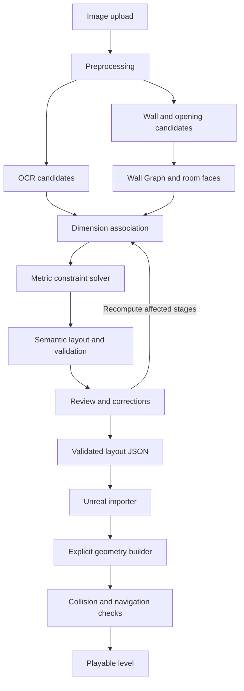

# PlayableSketch: kağıttaki çizimden Unreal level'a implementation rehberi

**İlk araştırma:** 13 Ekim 2026  
**Roadmap güncellemesi:** 21 Ekim 2026  
**Hedef proje:** PlayableSketch, Unreal Engine 5.7  
**Belgenin durumu:** Güncel implementation planı ve öğrenme rehberi. Drawing convention, v1 data contract, manual metric references ve sınırlı legacy JSON import hazır. Canonical explicit geometry/import, pretrained OCR ve geometry heuristics, topology correction UI ve Step 09 metric core/CLI hazır; Step 10 metric review UI hazır; Step 11 persistent jobs ve async upload→Unreal orchestration hazır; Step 12 flat-floor collision-grid/Pawn ve lifecycle verification hazır; Step 13 frozen evaluation, robustness, correction telemetry ve release gate hazır. Tamamlanan işlerin kapsamı aşağıda kayıtlı; yeni bölümlerdeki class, command ve file isimleri açıkça proposal olarak belirtilir.

Bu rehberin hedefi şu akışı kurmak:

> Kullanıcı kağıda top-down bir level çizer, duvarların yanına cm ölçülerini yazar, fotoğrafı yükler. Sistem çizgileri, ölçüleri ve bağlantıları yorumlar; belirsiz kısımları kullanıcıya gösterir; doğrulanan planı gerçek ölçülerle Unreal'da üretir.

English technical terms özellikle korunmuştur. Step 01–04 numaraları korunmuştur; implementation planı **Step 05–14 arasında toplam 10 Step** olarak düzenlenmiştir. Step 05–14 core implementation tamamlandı; Step 14 local Mac packaged runtime kapsamında doğrulandı. Step 00 mevcut baseline için referanstır. Her kalan Step bağımlılık, input/output, uygulama sırası, algoritma mantığı, test senaryoları, bitiş koşulu ve arama terimleri içerir. Sonraki ürün genişletmelerinde mevcut kapsam ve release gate’leri esas alınacak.

**16 Ekim 2026 uygulama notu:** Step 08 topology MVP ve English topology correction UI hazır. Her image upload zorunlu review açar; automatic detection başarısız olursa manual correction açılır. Step 10 review/revision ve Step 11 upload/jobs altyapısının bir kısmı erkenden implement edildi; metric solving, metric review ve upload→Unreal bağlantısı henüz tamamlanmadı. Güncel kullanım: [Topology review](step08_topology_review.md). Product/deployment ve ek data planı: [Product architecture](product_architecture.md).

**19 Ekim 2026 dataset/evaluation notu:** Dataset 50 gerçek çizim, 70 synthetic görüntü ve 600 augmentation ile 720 görüntüye ulaştı. Offline TrOCR recognition fine-tuning ve gruplandırılmış development-test karşılaştırması tamamlandı; experimental checkpoint mevcut UI'daki RapidOCR weights'in yerine geçirilmedi. Wall/topology modeli eğitilmedi ve Step 09 metric solving hâlâ sıradaki ana implementation işi. Sonuçlar ve sınırlar: [Dataset evaluation ve OCR fine-tuning](data_training_evaluation_v1.md).

**21 Ekim 2026 Step 09 notu:** Dimension association proposals, bounded hypotheses ve exact metric constraint solver implement edildi. Current accepted Step 08 revision ve confirmed measurement bindings ile pending metric draft üretir; source integrity, rank/residual ve custom validation kontrolleri çalışır. Eksik ölçüler null, confirmed conflicts görünür kalır; otomatik metric acceptance veya Unreal export yoktur. Sıradaki ana iş Step 10 metric review UI. Kullanım ve verification: [Step 09 metric solving](step09_metric_solving.md).

**21 Ekim 2026 Step 10 notu:** Metric review UI ve explicit accepted snapshot download implement edildi. Kullanıcı OCR value/target, missing dimensions, room/corridor semantics, settings ve Start/Goal'ü düzeltebilir; source/revision checks geçmeden accepted export oluşmaz. Sırada Step 11 service/jobs ve upload→Unreal orchestration var. Kullanım: [Step 10](step10_metric_review.md).

**21 Ekim 2026 Step 11 notu:** Persistent jobs ve upload→review→accepted export→async Unreal canonical import bağlantısı implement edildi. Gerçek Data_2 için inference CLI smoke ve ayrı controlled fixture için live local-service Unreal import doğrulandı. Missing/conflicting/stale sonuçlar accepted endpoint'e giremiyor. Sırada Step 12 collision/navigation ve actual Pawn verification var. Ayrıntılar: [Step 11](step11_pipeline_jobs_unreal.md).

**21 Ekim 2026 Step 12 notu:** Explicit collision-grid ve actual swept capsule Pawn verification tamamlandı. Shared wall, corridor ve T junction geçişleri; narrow door, low lintel, floor disconnect ve prop blockage; ayrı Unreal process save/reopen, Local/Full ve BeginPlay test edildi. V1 flat-floor adapter kullanılır; NavMesh/AI ve gravity/stairs certification kapsam dışıdır. Sırada Step 13 evaluation/robustness var. Kullanım: [Step 12](step12_physical_navigation.md).

**21 Ekim 2026 Step 14 notu:** Unreal Editor dışında çalışan Mac package, browser upload/review, accepted revision import, atomic ready state, actual Pawn play ve iki bankalı SaveGame tamamlandı. Core Step 05–14 bitti. Model accuracy ve Step 13 autonomous/general-release gate’leri değişmedi. [Step 14 raporu](step14_packaged_runtime.md).

**21 Ekim 2026 Step 13 notu:** Evaluation ve robustness tamamlandı: 720 cached inference artifact, 50 solver reference ve ayrı Step 12 physical kanıtları raporlanıyor. Human originals için numeric exact recall 232/512, opening F1 %29.92, exact topology 7/40 scorable; eksik stage’ler null. Correction timing yeni revision’larda ölçülür; geçmiş insan süreleri uydurulmaz. Autonomous release; unseen-writer test, gerçek correction cost ve latency gerekleri nedeniyle kapalı. Step 14 daha sonra tamamlandı. [Step 13 raporu](step13_evaluation_robustness.md).

## 1. Önce ana fikri anlayalım

Bu özellik, mevcut procedural generation sistemine bir **Sketch-to-Level authoring pipeline** eklemek demek. Ana problem resmi 3D mesh'e çevirmekten önce, resimdeki çizimin ne anlama geldiğini güvenilir bir veri modeline çevirmek.

Bir fotoğrafta `600` yazısını okumak ayrı bir iş; bu sayının hangi duvara ait olduğunu bulmak ayrı bir iş; o duvarın diğer duvarlarla birlikte kapanan, çakışmayan bir plan oluşturmasını sağlamak ayrı bir iş.

Önerdiğim ana yapı:

```text
Image
  → Image Preprocessing
  → OCR + Wall/Opening Detection
  → Wall Graph + Dimension Association
  → Geometric Constraint Solving
  → Review / Correction
  → Validated Metric Layout
  → Unreal Import
  → Geometry + Collision + Navigation
```

Buradaki **Metric Layout**, “şu pikselde siyah çizgi var” yerine “v0 ile v1 arasında 600 cm uzunluğunda bir wall var, üzerinde şu aralıkta bir door opening var” diyen veridir.

### Sistemin çözmesi gereken dört farklı problem

| Problem | Sorulan soru | Çıktı örneği |
| --- | --- | --- |
| Perception | Fotoğrafta ne görüyorum? | Line segments, text boxes, `600`, door candidates |
| Association | Hangi bilgi hangi elemana ait? | `600` → wall w0; opening d0 → wall w6 |
| Reconstruction | Bu bilgilerle nasıl bir plan oluşur? | cm coordinates, closed room polygons, shared walls |
| Generation | Bu planı Unreal'da nasıl üretirim? | Floors, walls, openings, collision, playable path |

Örneğin OCR'ın doğru olması, Association'ın doğru olduğunu göstermez. `600` doğru okunup yanlış duvara bağlanabilir. Geometry'nin güzel görünmesi de navigation'ın doğru olduğunu göstermez. Bu yüzden aşamalar ayrı output ve ayrı validation üretmeli.

### “İstediği düzeni çizsin” hedefini nasıl büyüteceğiz?

V1 convention sabitlendi: top-down, tek floor, rectangular/square rooms ve rectangular corridors, horizontal/vertical wall centerlines, açık cm labels ve tanımlı openings. İki room doğrudan shared wall üzerinden veya çizilmiş corridor ile bağlanabilir. Birleşik level'ın dış sınırı rectangle olmak zorunda değildir; her room/corridor rectangle olmalıdır. L-shaped room, diagonal/curved walls, stairs ve multi-floor layouts ayrı future scope'tur.

Bu dar başlangıç ürünün son sınırı değildir. İlk çalışan pipeline'ın hangi girdilerde doğru çalıştığını ölçebilmek için belirlenmiş kapsamdır.

## 2. Mevcut PlayableSketch'e nasıl oturuyor?

İncelediğim kaynaklarda mevcut sistem şu yapıya sahip:

| Mevcut parça | Şu anki rolü | Yeni özellikte kullanımı |
| --- | --- | --- |
| [PlayableSketchRoom.h](/Users/pelinsukaleli/PlayableSketch/Source/PlayableSketch/Public/SpatialGraph/PlayableSketchRoom.h:29) | `WidthCm`, `DepthCm`, `PositionCm`, `Auto/Locked` | Rectangular import için adapter hedefi |
| [PlayableSketchConnection.h](/Users/pelinsukaleli/PlayableSketch/Source/PlayableSketch/Public/SpatialGraph/PlayableSketchConnection.h:23) | İki room, corridor/door width, manual door settings | Mevcut room/corridor layout'larına sınırlı adapter |
| [PlayableSketchGraphAsset.h](/Users/pelinsukaleli/PlayableSketch/Source/PlayableSketch/Public/SpatialGraph/PlayableSketchGraphAsset.h:30) | Graph ve saved placements | Editor authoring, stable IDs, layout persistence yaklaşımı |
| [PlayableSketchFloorPlan.h](/Users/pelinsukaleli/PlayableSketch/Source/PlayableSketch/Public/Layout/PlayableSketchFloorPlan.h:42) | Rectangular room bounds, corridor footprints | Mevcut geometry/navigation contract'ı |
| [ReadSavedRooms](/Users/pelinsukaleli/PlayableSketch/Source/PlayableSketch/PlayableSketchLevelActor.cpp) | `Locked` coordinates veya saved Auto placements okur | Çizilmiş room position'larını korumak için temel |
| [BuildCandidate](/Users/pelinsukaleli/PlayableSketch/Source/PlayableSketch/PlayableSketchLevelActor.cpp) | Doors → corridor routing → walls → validation | Explicit sketch geometry için ayrılması gereken nokta |
| [Geometry descriptors](/Users/pelinsukaleli/PlayableSketch/Source/PlayableSketch/Public/Geometry/PlayableSketchWallGeometry.h:37) | Axis-aligned wall/lintel boxes | Orthogonal wall generation için yeniden kullanılabilir yaklaşım |
| [Navigation analysis](/Users/pelinsukaleli/PlayableSketch/Source/PlayableSketch/Public/Navigation/PlayableSketchNavigation.h:67) | Geometry üzerinden grid navigation | Yeni import'un fiziksel kontrolüne temel |

### En önemli integration farkı

Mevcut `Connection`, iki room arasında door endpoints ve routed corridor üretmeye yönelik. Kağıttaki iki room ise **aynı wall'ı paylaşabilir** ve aralarında yalnızca bir door opening olabilir. Bu durumda yeni corridor oluşturmak çizimi değiştirir.

Üstelik mevcut `BuildCandidate`, `RebuildGeometry()` içinde bile door generation ve corridor routing çalıştırıyor. Yalnızca `PositionMode = Locked` vermek, bütün çizimi korumak için yeterli değil. Room positions korunabilir; doors ve corridor path yeniden hesaplanabilir.

İki integration katmanı artık mevcut:

1. **Legacy adapter:** Mevcut modele gerçekten uyan rectangular rooms + supported corridors. İlk JSON import bağlantısını göstermek için.
2. **Explicit metric layout builder:** Wall Graph, openings, room polygons ve explicit corridor footprints üzerinden doğrudan geometry. Ortak duvarlı planlar için ana hedef.

İki yol ortak validation/reporting ve mümkün olan component build altyapısını paylaşabilir. Veri modelinin farklı olduğu yerlerde adapter gerekir.

### Başlangıç referansı

[README'deki 11 Ekim 2026 kayıtlı deneyde](/Users/pelinsukaleli/PlayableSketch/README.md:154), 30 automatic-generation case'inin 10'u geometry validation'dan geçmiş; bu 10 case'in navigation sonucu unreachable. Branching/ring case'lerinde door overlap hataları kayıtlı. Bu değerler bu rehber için yeniden çalıştırılmış sonuçlar değil, repository'deki baseline kayıtlarıdır.

Çizim sistemi, Auto placement'ı bypass ederek bazı generation problemlerinden kaçınabilir. Bu durum mevcut geometry/navigation davranışının otomatik olarak düzeldiği anlamına gelmez. Step 00'da known fixtures ile mevcut durum ayrı ölçülmeli.

## 3. Önerilen architecture



Review'da topology değişirse Wall Graph aşamasına da dönülür. Diagram ana yolu gösterir; her correction yalnızca Association'a gitmez.

### Hangi teknoloji hangi işi yapacak?

| Katman | İlk tercih | Seçim mantığı |
| --- | --- | --- |
| Image pipeline | Python, OpenCV, NumPy | Intermediate images ve geometry debugging kolay |
| OCR | PaddleOCR candidate; handwriting için TrOCR karşılaştırması | Kendi digit/label örneklerinde ölçerek seçilecek |
| Geometry operations | Shapely | Line noding, polygonization, validity ve offsets |
| Metric solving | NumPy + SciPy | Residual hesapları, robust estimation, optimization |
| Data contract | JSON Schema Draft 2020-12 + `jsonschema` + custom validation | Step 03'te implement edildi; Pydantic API katmanında optional |
| İlk bridge | JSON file export/import | HTTP/UI'dan önce contract'ı doğrular |
| API, sonraki aşama | FastAPI | Upload ve job/result endpoints |
| Review UI | Basit 2D canvas/SVG editor | Kullanıcı wall, number, association ve opening düzeltebilsin |
| Unreal integration | C++ importer + Editor UI | Mevcut C++ proje yapısına uygun; runtime yolu ayrılabilir |
| Geometry output | Önce StaticMesh boxes + openings | Orthogonal layout için mevcut yaklaşıma yakın |
| İleri geometry | DynamicMesh / Geometry Script seçenekleri | Nonrectangular floor veya daha karmaşık mesh ihtiyacında |
| İleri perception | Segmentation/junction model veya VLM | Ölçülen hata türüne göre eklenir |

Contract ve legacy import dışındaki teknoloji seçimleri engineering önerisidir. Mevcut 10 fotoğrafta henüz OCR benchmark çalıştırılmadı; “şu model kesin en iyi” sonucu çıkarılamaz. Özellikle Windows/CUDA ve macOS acceleration için aynı OCR/model stack'inin sorunsuz çalışacağını varsayma; ayrı environment smoke test yap.

Unreal'ın distance default'u cm; coordinate system'i Z-up ve left-handed. Bu nedenle ara modelde cm seçmek uygundur; yine de image axes ile Unreal axes arasındaki mapping açıkça yazılmalı. [Epic units](https://dev.epicgames.com/documentation/en-us/unreal-engine/units-of-measurement-in-unreal-engine?application_version=5.7), [Epic coordinates](https://dev.epicgames.com/documentation/en-us/unreal-engine/coordinate-system-and-spaces-in-unreal-engine?application_version=5.7).

## 4. Development sırası ve güncel durum

### Şu anda ne hazır?

| Step | Durum | Somut artifact ve sınır |
| --- | --- | --- |
| 00 | Baseline referansı; kısmi verification | Step 04 sırasında Mac build ve mevcut automation suite geçti. İnteraktif save/reopen ve actual Pawn traversal hâlâ ayrıca doğrulanacak. |
| 01 | Tamamlandı | [Drawing Convention v1](/Users/pelinsukaleli/PlayableSketch/Docs/drawing_convention_v1.md). Units cm; offset corner→near opening edge. |
| 02 | Manual reference aşaması hazır | 10 original photo, 10 observations, 10 drafts, 8 accepted metric references. Pixel annotations Step 06 ile ayrı revision olarak hazır; metric completeness ayrı tutuluyor. |
| 03 | Tamamlandı | [Layout Data Contract v1](/Users/pelinsukaleli/PlayableSketch/Docs/layout_data_contract_v1.md), strict schemas ve custom validators. |
| 04 | Sınırlı kapsamıyla tamamlandı | [Legacy JSON import](/Users/pelinsukaleli/PlayableSketch/Docs/step04_json_import.md): iki room + straight corridor + eşit width'li iki door. Legacy butonu canonical v1 tüketmez. |
| 05 | Implement edildi; automation ile doğrulandı | [Canonical explicit import](/Users/pelinsukaleli/PlayableSketch/Docs/step05_explicit_layout.md): Data_1–8, shared walls, doors/open passages, settings revisions ve Local/Full rebuild. Agent navigation Step 12 kapsamı. |
| 06 | Implement edildi; Python testleri ve visual review ile doğrulandı | [Pixel annotations ve preprocessing](/Users/pelinsukaleli/PlayableSketch/Docs/step06_preprocessing.md): 10 fotoğraf, 56 text region, reversible transforms ve debug overlays. |
| 07 | Baseline implement edildi; accuracy sınırları ölçüldü | [OCR ve perception](/Users/pelinsukaleli/PlayableSketch/Docs/step07_perception.md): independent predictions, alternatives, Hough/LSD karşılaştırması; numeric exact 40/56, opening recall 4/11. |

Step 04'ün 14 Ekim 2026 kayıtlarında 43 Python test ve 6 Unreal automation test başarılı; Mac Development Editor build geçti. Bu, fotoğraftan otomatik reconstruction accuracy'si veya gerçek Pawn playtest sonucu değildir. Step 05 verification kayıtları ve güncel test sonuçları kendi implementation belgesinde tutulur.

### Step 05–14: 10 Step'lik implementation planı

| Yeni Step | Kapsam | Step sonunda elde edeceğimiz sonuç |
| --- | --- | --- |
| 05 | Canonical import, explicit geometry, persistence, Local rebuild | Implement edildi: manual v1 layout Unreal'da topology korunarak oluşuyor. |
| 06 | Pixel annotations, image input, preprocessing | Implement edildi: manual pixel references, transforms, quality report ve review overlays hazır. |
| 07 | OCR, wall ve opening perception | Implement edildi: original-frame observations, alternatives, evidence crops ve dev metrics hazır; opening recall sınırlı. |
| 08 | Wall Graph, room/corridor topology, passage semantics | Implement edildi: topology hypotheses ve pixel correction/approval UI hazır. |
| 09 | Dimension association ve metric constraint solving | Implement edildi: confirmed ölçülerden cm draft, rank/residual ve missing/conflict raporu. |
| 10 | Review UI, corrections, revision yönetimi | Implement edildi: metric corrections, immutable undo/redo, named acceptance ve validated JSON download. |
| 11 | CLI, service/jobs ve Unreal end-to-end akışı | Implement edildi: persistent jobs, atomic exports ve async selected-revision Unreal import. |
| 12 | Collision, navigation, Pawn ve lifecycle verification | Layout'un seçili agent ile gerçekten geçilebilirliği ölçülür. |
| 13 | Evaluation, robustness ve gerektiğinde model iyileştirme | Frozen benchmark, failure analysis ve kanıtlanmış iyileştirmeler oluşur. |
| 14 | Packaged runtime ve procedural authoring entegrasyonu | Editor dışındaki kullanıcı aynı akışı çalıştırabilir; optional decoration geometry'yi korur. |

**Bağımlılık:** Step 05 contract'ı kullanır; OCR'ı beklemez. Step 06–09 image tarafını kurar. Step 10 UI'ı ilk olarak manual drafts ile geliştirebilir; gerçek predictions hazır olunca aynı contract'a bağlar. Step 11 mevcut modülleri servisleştirir. Step 12'nin temel collision kontrolleri Step 05'te başlar; Step 13'ün metrics'i ilgili stage yazılırken kaydedilir. Bunları sona kadar tamamen ertelemeyeceğiz.

### Milestones

| Milestone | Steps | Kabul edeceğimiz somut sonuç |
| --- | --- | --- |
| M0 — Contract ve ilk bağlantı | 01–04 | Mevcut convention, references, validators ve dar legacy import. |
| M1 — Explicit level | 05 | Single room, shared-wall rooms, explicit corridor; positions ve openings korunur. |
| M2 — Fotoğraftan metric draft | 06–09 | Evidence'ı izlenebilen cm reconstruction veya açıklanabilir review issues. |
| M3 — Kullanılabilir Editor akışı | 10–11 | Upload, correction, accepted revision ve transactional Unreal import. |
| M4 — Ölçülen playable Editor sürümü | 12–13 | Collision/Pawn doğrulaması, frozen evaluation ve hata raporu. |
| M5 — Runtime ürün akışı | 14 | Packaged build'de upload→review→generation→play. |

Learned model training, VLM ve PCG zorunlu milestone değildir. Baseline hedefi karşılıyorsa Step 13'ün model branch'i atlanabilir; Step 14'te decoration optional kalır. Kullanıcının packaged uygulamadan image yükleme hedefi için runtime delivery gereklidir. Böylece optional araştırma işleri core pipeline'ı gereksiz yere büyütmez.

### Eski rehberden yeni numaralara geçiş

Bu tablo yalnızca önceki konuşmalardaki Step numaralarını bulmak içindir. Bundan sonraki implementation taleplerinde **yeni numaralar** kullanılacak.

| Eski Step | Yeni Step | Birleştirme mantığı |
| --- | --- | --- |
| 00–04 | 00–04 | Önceki tamamlanan işler ve referanslar korundu. |
| 05 + 15 | 05 | Geometry ve onun import/persistence lifecycle'ı aynı teslimat. |
| 06 + Step 02'nin kalan pixel annotation işi | 06 | Preprocessing'i değerlendirecek reference data birlikte hazırlanır. |
| 07 + 08 | 07 | OCR ve çizgi/gap detection aynı perception katmanı. |
| 09 + 12 | 08 | Wall topology, region classification ve passage semantics birlikte kurulur. |
| 10 + 11 | 09 | Association hypotheses global metric consistency ile birlikte değerlendirilir. |
| 13 | 10 | Review ve revision tek authoring aşaması. |
| 14 | 11 | CLI/service/job orchestration ve uçtan uca bağlantı. |
| 16 | 12 | Fiziksel playability ve lifecycle verification. |
| 17 + 18 | 13 | Evaluation sonucuna göre model yatırımı. |
| 19 + 20 | 14 | Runtime delivery ve mevcut procedural sistemle ürün entegrasyonu. |

### Bütün kalan Steps için çalışma kuralı

Her Step önce manual/reference input ile bağımsız çalışır, sonra önceki stage'e bağlanır. Reference JSON'ları prediction output ile overwrite etmeyiz. Çalışma artifacts'ı `Saved/SketchImports/` altında ayrı tutulur. Algoritma değişince input hash, config ve sürüm kayıtlarıyla farkı açıklayabiliriz.

Mevcut schemas strict'tir. Aşağıda geçen `candidate alternatives`, `topology hypotheses`, `solver residuals`, `job state` gibi ayrıntılar gerektiğinde **ayrı working/debug artifacts** olur. Mevcut JSON'a tanımsız fields eklemek yerine schema değişikliği gerekiyorsa explicit versioning ve validation yapılır. `validated_layout` yalnızca tanımlı v1 fields'ı taşır.

Her Step'in bitiş koşulu geçmeden onu tamamlandı saymayacağız. Bir Step içindeki numaralı implementation işleri ayrı roadmap Step'leri değildir; bu implementation planı toplam 10 Step içerir; Step 11 sonrasında Step 12–14 arasında 3 Step kalır.

---

## Step 00 — Mevcut generation ve navigation baseline'ını sabitle

**Güncel durum:** Baseline yaklaşımı korunuyor. Headless verification kayıtlı; actual Pawn ve save/reopen Step 12 teslimatında tamamlanacak. Aşağıdaki `baseline_notes.md` bir output önerisidir.

**Amaç:** Yeni özelliğin hangi parçaları devralacağını ve mevcut hataların nerede olduğunu belirlemek.

**Input:** Mevcut proje, kayıtlı deneyler, validation tests.  
**Output:** `baseline_notes.md`, küçük reference fixtures ve her fixture için beklenen stage sonuçları.

### Implementation işleri

1. Mevcut projeyi geliştirme ortamında build et. Step 04 kayıtlarında macOS/UE 5.7.2 Development Editor build doğrulandı; komut ve ortam ayrıntıları `step04_json_import.md` içinde. README'deki eski Windows kaydını bu Mac verification'dan ayrı değerlendir.
2. Auto generation'dan bağımsız iki rectangular room ve straight corridor içeren bir Locked fixture seç veya oluştur.
3. Graph validation, geometry validation ve navigation sonuçlarını ayrı kaydet.
4. Wall collision ve openings'i viewport'ta incele; bir Pawn ile ayrıca kontrol et.
5. Shared wall içeren ikinci fixture'ı **yeni explicit builder'ın hedefi** olarak tanımla. Mevcut builder'ın bunu desteklediğini varsayma.
6. Actor scale'i `(1,1,1)` tut; mevcut navigation horizontal local coordinates kabul ediyor.

### Mantık

Yeni bir resim yüklediğinde level yürünemiyorsa, bunun OCR hatası mı yoksa zaten var olan collision/grid davranışı mı olduğunu anlaman gerekir. Known JSON fixture, perception'ı denklemden çıkarır.

Mevcut Graph validator farklı Start ve Goal rooms istiyor. Tek room çizimi perception/geometry fixture'ı olarak kullanılabilir; mevcut gameplay Graph yoluna doğrudan verilemez. Step 03 contract'ta `geometry_only` mode artık var; Unreal üretim yolu Step 05 explicit builder ile tamamlanacak. Sahte ikinci room ekleyerek input'u değiştirme.

**Bitiş koşulu:** En az bir legacy fixture'ın stage sonuçları açıklanabiliyor; yeni builder için bir shared-wall fixture ve bir single-room geometry fixture tanımlı. Navigation başarısızsa nedeni araştırılıp ayrı issue olarak kayıtlı.

**Arama motoruna yaz:**

- `Unreal Engine automation tests procedural geometry validation` — geometry test yaklaşımı.
- `Unreal Engine collision debugging pawn capsule` — görsel açıklıkla collision farkı.
- `occupancy grid resolution narrow passage path planning` — mevcut navigation sınırlamasının mantığı.

**Projede oku:** [README limitations](/Users/pelinsukaleli/PlayableSketch/README.md:233), [Graph validator](/Users/pelinsukaleli/PlayableSketch/Source/PlayableSketch/Public/SpatialGraph/PlayableSketchGraphValidator.h:6).

## Step 01 — Drawing convention ve ilk input kapsamını tanımla

**Güncel durum:** Tamamlandı. Ayrıntılarda [Drawing Convention v1](/Users/pelinsukaleli/PlayableSketch/Docs/drawing_convention_v1.md) esas alınır.

**Amaç:** Çizimin yorumlanabilir bir dili olsun.

**Input:** Ürün hedefin.  
**Output:** `drawing_convention_v1.md` ve doğru/yanlış örnek çizimler.

### İlk sürümün kabul edilen kuralları

- Top-down, tek floor, horizontal zemin.
- Düz kağıt; tercihen boş A4 veya bilinen aspect ratio'lu template.
- Rectangular/square rooms ve rectangular corridors. Walls horizontal/vertical; küçük freehand sapmaları ideal düz wall olarak yorumlanabilir.
- Bir wall tek çizgiyle gösterilir. Bu çizgi **wall centerline** kabul edilir.
- Yazılan cm sayısı, belirtilen iki junction arasındaki centerline length'tir.
- Ölçü `700 cm` gibi, ilgili wall/span'e paralel ve mümkün olduğunca ortasına yakın yazılır. Çizginin üstüne bindirilmez. Yakın walls veya kalabalık bölgelerde extension lines/ticks ile endpoints gösterilir.
- Door için wall üzerinde gap, opening kenarlarında wall'ı dik kesen iki kısa tick ve `120 cm` gibi clear width kullanılır; `D` optional. Offset, room corner'dan ölçüm yönündeki near opening edge'e kadar ölçülür; center = edge offset + clear width/2 olarak türetilir (16 Ekim 2026 author correction). Corridor zorunlu değildir; iki room shared wall'daki door ile doğrudan bağlanabilir.
- Room name optional. Start/Goal ilk sürümde review sırasında seçilebilir.
- Wall thickness, wall height ve door height çizimden çıkarılmaz; user settings/defaults olarak verilir.

Örnek settings: thickness 20 cm, height 300 cm, door height 220 cm, floor thickness 20 cm. Wall thickness ve Z yönündeki height sistem settings'inden değiştirilebilir; değişiklik derived geometry'yi yeniden hesaplatır. Bunlar çizimde görünmeyen bilgi için önerilen defaults'tur, tespit edilmiş ölçüler değildir.

### Ana mode ile olası future mode arasındaki fark

**Dimension-driven reconstruction:** Serbest çizim ölçüye uygun çizilmemiş olabilir. Fotoğraf topology ve yaklaşık relative arrangement verir; yazılı ölçüler metric layout'u belirler. Bu projenin ana hedefi için önerdiğim mode budur.

**Scaled tracing:** Kullanıcı gerçekten ölçekli çizmiştir. Bir veya birkaç known span üzerinden cm/pixel tahmin edilir; tüm çizim yaklaşık aynı scale ile büyütülür. V1'in ana mode'u değildir; ileride ayrı input mode olarak eklenebilir.

`600` yazılmış 300 px wall ile `400` yazılmış 250 px wall'ın scale oranları farklı olabilir. Bu doğrudan OCR hatası anlamına gelmez; kullanıcı ölçeksiz çizmiş olabilir.

### Ölçünün neyi ifade ettiği neden kritik?

600 cm centerline width ve 20 cm wall thickness ile basit rectangular room'un net iç width'i yaklaşık `600 - 10 - 10 = 580 cm` olur. `600` net iç ölçü ise centerline distance farklıdır. İlk sürümde bu iki convention'ı karıştırma. İleride `dimension_basis = clear_inside / wall_centerline / outer_face` seçenekleri eklenebilir; conversion wall thickness ve hangi surfaces'ın ölçüldüğünü kullanmalı.

**Bitiş koşulu:** Başka biri convention'ı okuyarak 5 örnek plan çizebiliyor; her sayı için “hangi endpoints ve hangi measurement basis?” sorusunun cevabı var.

**Arama motoruna yaz:**

- `architectural dimension lines extension lines dimension association` — sayının hangi span'e ait olduğunu anlamak.
- `floor plan wall centerline vs clear dimensions` — measurement basis farkı.
- `sketch based floor plan reconstruction constraints` — serbest sketch'ten plan çıkarma problemi.

## Step 02 — Küçük bir dataset ve ground truth hazırla

**Güncel durum:** [10 fixture için manual metric references](/Users/pelinsukaleli/PlayableSketch/Data/ground_truth/v1/README.md) korunuyor. Step 06 ile [ayrı pixel annotation revision](/Users/pelinsukaleli/PlayableSketch/Data/annotations/v1/README.md) hazırlandı: text polygons, wall/tick traces, opening regions ve measured-span associations. Bunlar manual development references; automated detection sonucu veya bağımsız benchmark değildir.

**Amaç:** Algoritmayı kendi çizim türünde ölçebilmek.

**Input:** Drawing convention.  
**Output:** Images, annotations, reference metric layouts ve frozen test split.

### Implementation işleri

1. Başlangıç için örneğin 30–50 farklı çizim topla. Bu sayı bir accuracy garantisi değil, ilk hata analizi için pratik bir öneri.
2. Tek room, iki shared-wall room, horizontal/vertical corridor, T junction, birden çok door ve bilinçli hatalı ölçü örneklerini ayrı etiketle.
3. Bazı planların düz tarama, eğik telefon fotoğrafı, gölgeli fotoğraf ve farklı handwriting sürümlerini üret.
4. Her örnekte text transcription + text polygon; wall endpoints/centerlines; opening location/width; room polygons; dimension associations kaydet.
5. Metric ground truth'u fotoğraftan piksel ölçerek değil, önceden belirlenmiş ölçülü plan veya doğrulanmış annotation üzerinden oluştur.
6. `train/dev/test` ayrımını **base plan ve writer** üzerinden yap. Aynı çizimin 5 fotoğrafının train ve test'e dağılması data leakage yaratır.

### Mantık

Gerçek test “Hough line çizdi mi?” değil, “doğru duvarı doğru sayıyla eşleştirip doğru playable layout'u üretti mi?” sorusudur. Bir örneğin her aşamasındaki ground truth farklı hata türlerini görmeni sağlar.

CubiCasa5K, floor plan analysis için 5.000 örnek içeren bir araştırma dataset'idir. Senin handwriting, phone-photo ve cm association problemine doğrudan eşdeğer değildir. Araştırma/referans için yararlıdır; kendi domain test set'inin yerine geçmez. Kullanacağın dataset, code ve weights'ın license koşullarını ilgili artifact üzerinden incele. [CubiCasa repository](https://github.com/CubiCasa/CubiCasa5k), [paper](https://arxiv.org/abs/1904.01920).

**Bitiş koşulu:** En az 10 fixture için metric reference ve image annotations mevcut; bunların bir kısmı dev tuning'den ayrı tutulmuş. Yanlış/belirsiz girdiler de dataset'te var.

**Arama motoruna yaz:**

- `floorplan parsing dataset junction wall door annotations` — hangi annotation türleri gerekiyor.
- `CubiCasa5K dataset floorplan analysis` — benzer research problemi.
- `hand drawn floor plan dataset domain gap` — hazır modelin neden doğrudan çalışmayabileceği.
- `machine learning dataset split by subject data leakage` — writer/plan bazında split mantığı.

## Step 03 — Intermediate Representation ve versioned JSON contract

**Güncel durum:** Implement edildi. Ayrıntılar: [Layout Data Contract v1](/Users/pelinsukaleli/PlayableSketch/Docs/layout_data_contract_v1.md). Bu bölüm mevcut contract'ın mantığını özetler; yeni implementation isteği değildir.

**Amaç:** Python, Review UI ve Unreal'ın aynı wall, opening ve dimension'ı aynı anlamla kullanması.  
**Input:** Convention ve manual fixtures.  
**Output:** Üç schema, shared definitions, strict loading, custom metric validation ve converted references.

### Üç veri seviyesi

| Document | Mevcut version | Ne anlatır? |
| --- | --- | --- |
| `observations` | `playablesketch-observations/1.0` | Image'da görülen texts, lines ve opening candidates; yanlış olabilir. |
| `draft_layout` | `playablesketch-layout/1.0` | Topology ve provisional metric geometry; null/missing/conflicting bilgi taşıyabilir. |
| `validated_layout` | `playablesketch-layout/1.0` | Review acceptance ve yeniden hesaplanan metric checks'ten geçmiş snapshot. |

Schemas [SketchPipeline/schemas](/Users/pelinsukaleli/PlayableSketch/SketchPipeline/schemas) altında; JSON Schema Draft 2020-12, local URN registry ve `additionalProperties: false` kullanılır. [Validator](/Users/pelinsukaleli/PlayableSketch/SketchPipeline/validation/validate.py) duplicate keys, NaN/Infinity, wrong types, unsupported versions ve tanımsız fields'ı reddeder. Geometry validation schema validation'dan ayrıdır. Pydantic mevcut implementation'ın dependency'si değildir.

### Canonical layout'un ana entities'i

| Entity | Görev ve invariant |
| --- | --- |
| Vertex | Shared junction için tek ID ve `[x,y]` cm coordinate. |
| Wall | Positive x/y direction, iki vertex, thickness/height ve owning region IDs. Shared wall tek entity. |
| Room / Corridor | Counterclockwise rectangular boundary; T junction için collinear extra vertices olabilir. |
| Opening | Bir supporting wall, wall start→center offset, clear width/height ve iki typed connected entity. |
| Passage | Bir opening'in gerçekten bağladığı regions. Adjacency tek başına passage değildir. |
| Dimension | Value, measurement basis, target, evidence state ve provenance. |
| Revision / Review | Immutable snapshot kimliği, parent revision ve acceptance bilgisi. |

Entities root'taki `layout` altında bulunur. Wall IDs'yi iki room içinde kopyalamayız; boundaries aynı wall'a reference verir. Room/corridor centerline polygons ile clear walkable area farklıdır.

### Coordinates ve ölçünün referansı

Image evidence px kullanır: u sağa, v aşağıya. Metric geometry cm kullanır: x sağa, y yukarıya, z yukarıya; intended Unreal mapping X=x, Y=y, Z=z. Working image transforms ayrıca kayıtlı olmalı; farklı frames'deki points birbirine doğrudan karşılaştırılmaz.

Room/wall dimensions `wall_centerline`, opening width `clear_opening` basis kullanır. Paper opening offset room corner→near edge'dir (`Dimension.basis: edge_offset`); `Opening.center_offset_cm` supporting wall start→derived center'dır. Data_8'de paper edge offset 300 cm ve clear width 120 cm center y=360 verir; noded wall-local center offset 100 cm'dir. İkisini aynı field gibi kullanmak door'u yanlış yere taşır.

Dimension targets mevcut contract'ta `region_span`, `wall_chain`, `opening_width`, `opening_offset` ve draft-only `unassigned` türleridir. T junction toplam ölçüsü split edilen her edge'in ayrı length'i olmaz. Bilinmeyen değer `null` olur; `0` gerçek coordinate'dır.

### State ve acceptance mantığı

`confirmed`, `derived`, `inferred`, `missing`, `conflicting` ayrıdır. OCR score calibrated probability değildir. Kullanıcının correction'ı eski observation'ı silmez; provenance ve yeni revision ile ilişkilendirilir.

`as_validated(draft, reviewer, observations)` input'u değiştirmeden accepted copy üretir. Linked evidence varsa eşleşen observations gerekir. Sadece `status: validated` yazmak validator'ı geçirmez. `geometry_only` tek room ve null Start/Goal kabul eder. `gameplay`, farklı mevcut Start/Goal rooms ve tanımlı passage connectivity ister; fiziksel clearance/Pawn kontrolü yapmaz.

Global thickness/height/door height/floor thickness settings'tir. Resolved wall/opening fields bu settings'le uyumlu kalmalı. Settings değişirse derived values yeniden hesaplanır. 200 cm centerline corridor ve iki yanda 20 cm wall için 180 cm clear entrance türetilebilir; bu 200 cm door ölçüsü anlamına gelmez.

### Mevcut teslimatın kontrolü

Data_1–8 metric references kabul ediliyor. Data_9'daki 600/450 conflict ve Data_10'daki missing measurements export'u engelliyor. Bu files manual references; otomatik OCR çıktısı veya Unreal playability kanıtı değiller. Mevcut check komutları ve acceptance sınırı contract belgesinde kayıtlı.

**Arama motoruna yaz:**

- `intermediate representation compiler pipeline architecture` — perception ile geometry arasında neden ortak model var?
- `JSON Schema Draft 2020-12 strict validation local registry` — tip/format validation nasıl yapılır?
- `geometry topology stable identifiers incremental editing` — coordinates değişirken identity nasıl korunur?
- `data provenance immutable revisions human corrections` — hangi value nereden geldi?

## Step 04 — JSON'dan Unreal'a sınırlı legacy bağlantısı

**Güncel durum:** Implement edildi ve 14 Ekim 2026'da build/automation ile doğrulandı. Ayrıntılar, hazır örnek ve commands: [Step 04 import belgesi](/Users/pelinsukaleli/PlayableSketch/Docs/step04_json_import.md).

**Amaç:** Image pipeline'ı beklemeden JSON→Unreal bağlantısını göstermek.  
**Input:** Accepted canonical layout + observations + Start/Goal.  
**Output:** Dar bridge JSON, Editor import action, stable IDs ve import report.

### Gerçekte kurulan yol

```text
Manual canonical v1 layout
  → Python contract validation
  → export_legacy: centerline → clear-inside conversion
  → playablesketch-legacy-import/1.0
  → C++ Parse / Prepare
  → staged geometry + validation
  → publish components / graph metadata
```

[Python exporter](/Users/pelinsukaleli/PlayableSketch/SketchPipeline/import_bridge/export_legacy.py) canonical v1'i doğrular. [C++ importer](/Users/pelinsukaleli/PlayableSketch/Source/PlayableSketch/Public/Import/PlayableSketchLayoutImporter.h) **bridge formatı** tüketir; full v1'i parse etmez. Actor'da `Import Layout Json Path`, `Import Layout Json` ve `Last Import Report` bulunur.

Destek: tam iki rectangular room, tek straight horizontal/vertical corridor ve iki entrance'ta eşit clear width'li door. Shared-wall door, single room, open corridor entrance ve unequal doors bu yolun dışındadır. Bu nedenle Data_1–10 fotoğraflarından hiçbiri uyarlama uğruna değiştirilmedi; ayrı [synthetic example](/Users/pelinsukaleli/PlayableSketch/Data/import_examples/README.md) kullanıldı.

### Neden conversion gerekiyor?

Canonical model centerlines; legacy room bounds clear-inside kullanır. 600 cm centerline width ve 20 cm walls için clear width 580 cm olur. Door center offset de clear minimum corner'a göre rebase edilir. Corridor floor threshold boyunca uzatılabilir; bu conversion çizimde olmayan bir route üretmek anlamına gelmez.

Legacy dimensions `int32` olduğu için fractional clear width/depth sessizce yuvarlanmaz, reddedilir. Off-grid 435 cm test değeri 450'ye dönüşmez. Rooms `Locked`, doors manual olur. Corridor routing mevcut altyapıda çalışır; çıkan footprint beklenen straight footprint'e 0.001 cm içinde eşleşmezse import reddedilir.

### Publication ve verification sınırı

Parse/preflight asset'i değiştirmez. Candidate başarılı olunca staged publication ve Editor transaction uygulanır. Normal failed import önceki asset/preview'u korur. Stable GUID, document ID + entity kind + external ID'den türetilir; revision ID kimliği değiştirmez. Reimport duplicate components biriktirmez. Bu Editor-only action'dır; packaged upload değildir.

14 Ekim kayıtlarında 43 Python test ve 6 Unreal automation test başarılı; Mac build geçti. Mevcut authoring rejection testinde beklenen iki overlap warning var. Interactive viewport, actual save/reopen ve Pawn traversal ayrı acceptance işleridir. Step 05 canonical explicit yolu ekleyecek; Step 12 fiziksel sonucu doğrulayacak.

**Arama motoruna yaz:**

- `Unreal Engine C++ JSON deserialize FJsonSerializer` — parsing.
- `Unreal Engine CallInEditor import DataAsset transaction` — Editor action ve persistence.
- `coordinate basis conversion wall centerline clear inside` — dimensions neden conversion istiyor?
- `deterministic identifiers idempotent reimport` — tekrar import neden aynı logical objects'ı korumalı?

## Step 05 — Canonical import, explicit geometry, persistence ve Local rebuild

**Durum:** Implement edildi. Kullanım, mimari, verification ve kapsam sınırı: [Step 05 explicit layout](/Users/pelinsukaleli/PlayableSketch/Docs/step05_explicit_layout.md).  
**Amaç:** Accepted v1 layout'u placements, shared walls ve openings korunarak Unreal geometry'ye çevirmek; aynı layout'u save/reimport/rebuild boyunca korumak.  
**Bağımlılık:** Step 03 contract ve Step 04'teki parsing/staging deneyimi. OCR veya service gerekmez.  
**Input:** Data_1–8 accepted metric references, matching observations, global wall/floor settings; invalid draft fixtures.  
**Output:** Canonical C++ model/import path, explicit builder, persist edilen source asset, stable component ownership ve import/geometry report.

### Uygulama sırası ve ara teslimatlar

1. **Canonical parsing:** Legacy bridge parser'ından ayrı bir v1 entry point tasarla. `layout` entities, units, version, IDs, ownership, finite coordinates, opening intervals ve supported rectangular geometry kontrollerini C++ tarafında uygula. Matching evidence bundle verildiyse source/evidence identity kontrolünü de tanımla; Python checks'in tamamını yalnızca `validated` label'ından varsayma.
2. **Pure build aşaması:** Actor/components değiştirmeyen layout→descriptors fonksiyonu kur. Önce Data_1 rectangle, sonra Data_3 shared wall, ardından Data_6 corridor ve Data_8 split wall çalışsın. Intermediate descriptors test edilebilir olsun.
3. **Floors ve solids:** Her rectangular room/corridor için floor; her unique wall için solid intervals; her door için lintel üret. `open_passage` full-height açıklık olduğu için lintel üretme. Floors'un üstü z=0, thickness aşağıya uzansın; threshold bölgelerinde boşluk kalmasın.
4. **Joins ve openings:** T/L junction joins için tek ownership/join policy seç. Geometry'de üst üste gelen başka bir wall end cap opening'i kapatmamalı. Opening'in bütün solid footprints üzerinden açık kaldığını kontrol et.
5. **Source mode ve persistence:** Actor'a imported explicit source seçimi ekle. Bu mode'da auto placement/door selection/corridor routing çalışmasın. Asset source document/revision/settings ve canonical IDs'yi saklasın.
6. **Staged publication:** Parse→build→validate→publish sırasını koru. Publication başarısızsa önceki valid state korunmalı. Step 04'ün mevcut staging altyapısını uygun yerlerde paylaş.
7. **Reimport ve Local rebuild:** Aynı revision duplicate üretmesin. Changed wall/opening/floor IDs üzerinden affected descriptors hesapla; Local ve Full aynı geometry/collision sonucuna ulaşsın. Persist edilen asset save/reopen'da explicit source mode'u korusun.

### A. Wall centerline ve opening intervals'dan geometry

#### Bir wall nasıl 3D olur?

```text
A = (0, 0), B = (600, 0)
L = 600 cm, thickness = 20 cm, height = 300 cm
center = (300, 0, 150)
size = (600, 20, 300)
```

Opening center offset 250, clear width 120 ise boş interval `[190,310]` olur. Wall'ın `[0,190]` ve `[310,600]` parçaları tam height; `[190,310]` aralığında yalnızca door height üstü lintel üretilir. Opening width duvarın görünen gap'inden değil, collision'da kullanılabilir açıklıktan doğrulanmalı.

Birden fazla opening varsa intervals'ı start değerine göre sırala. Her interval `[0,L]` içinde olmalı ve başka opening ile overlap etmemeli. Full-height solid pieces, `[0,L]` içinden opening intervals çıkarılınca kalan aralıklardır. Her door interval'ına ayrıca lintel gelir; full-height open passage'a gelmez. Adjacent junction wall solids'ın opening içine taşması ayrıca kontrol edilir.

Horizontal wall'da kalan `[s,e]` parçasının center'ı `(A.x+(s+e)/2, A.y, H/2)`, size'ı `(e-s, thickness, H)` olur. Vertical wall'da center `(A.x, A.y+(s+e)/2, H/2)`, size `(thickness, e-s, H)` olur. Door clear height `h` ise lintel'in Z center'ı `(h+H)/2`, Z size'ı `H-h` olur. Böylece aynı interval mantığı iki wall axis için de çalışır.

Generic segment için `length = ||B-A||`, `midpoint = (A+B)/2`, yaw `atan2(dy,dx)` kullanılır. Ancak mevcut descriptor rotation taşımıyor ve navigation axis-aligned boxes kabul ediyor. Diagonal support için hem geometry descriptor hem collision/navigation contract'ı genişletilmeli.

Geometry Script/DynamicMesh, daha karmaşık geometry için seçenekler sunar. Bazı yollar runtime'da çalışabilirken `GeneratedDynamicMeshActor` rebuild hook'u editor-only'dir; seçilen API'ların UE 5.7 davranışı ayrıca kontrol edilmelidir. [Epic Geometry Scripting guide](https://dev.epicgames.com/documentation/en-us/unreal-engine/geometry-scripting-users-guide-in-unreal-engine?application_version=5.7).

### B. Import, identity ve asset lifecycle

#### Eklenen parçalar

Mevcut legacy importer ayrı tutuldu. Canonical path'in somut parçaları:

- `FPlayableSketchExplicitLayout`: canonical cm layout'un plain C++ modeli.
- `UPlayableSketchImportedLayoutAsset`: canonical JSON, document/revision ve image hash persistence.
- `FPlayableSketchExplicitLayoutBuilder::Parse`: strict canonical v1 ve metric/reference validation.
- `FPlayableSketchExplicitLayoutBuilder::Build`: floors, unique wall solids ve opening/lintel geometry.
- `FPlayableSketchExplicitLayoutBuilder::ResolveSettings`: centerlines korunarak resolved settings ve derived widths için yeni revision.
- `EPlayableSketchLayoutSource`: `ProceduralGraph` / `ImportedExplicitLayout` seçimi.
- Actor'da `Import Canonical Layout Json`: existing path alanını kullanan ayrı import action.

#### Mevcut altyapıda dikkat edilecekler

`FPlayableSketchGeometryDescriptor` ve validation, room/corridor source IDs ve axis-aligned boxes kabul ediyor. Yeni wall-owned layout için source ownership ve validation anlamı uyarlanmalı. Var olan `PublishCandidate`/component registry yaklaşımı paylaşılabilir; existing signature'ın yeni modeli doğrudan kabul ettiği varsayılmamalı.

Yeni schema/model data asset'i, eski `Graph.SchemaVersion` ile aynı version alanını paylaşmak zorunda değil. Eski assets'ı sessiz migrate etme; imported layout version'ı açık olsun.

### Bu Step'in önemli engineering kararları

Mevcut `FPlayableSketchLayoutImporter` legacy bridge'i tüketir. Canonical parser `FPlayableSketchExplicitLayoutBuilder::Parse` olarak ayrı implement edildi. Source mode ayrımı, kullanıcı sketch'inin procedural routing ile fark edilmeden değişmesini engeller.

Component key'i örneğin `(document_id, wall_id, solid_role, adjacent_opening_id)` gibi stable semantic bilgilerden oluşabilir; array index kullanılmamalı. Bir opening eklenince bazı wall pieces doğal olarak bölünür, fakat unrelated walls/floors yeniden kimlik almamalı. Local rebuild'in component reuse sağlaması, bütün solver/navigation hesaplarının otomatik olarak local olduğu anlamına gelmez; maliyet ayrı ölçülür.

Core kod [ExplicitLayout](/Users/pelinsukaleli/PlayableSketch/Source/PlayableSketch/Public/ExplicitLayout) altında. External image/observation links engine'de provenance olarak korunur; linked evidence validation Python/review gate'inde kalır. C++ import self-contained metric checks yapar. Mevcut axis-aligned descriptor ve grid assumptions v1'e uygundur; polygon rooms/diagonals bu Step'in gereği değildir.

### Test senaryoları ve beklenen davranış

| Fixture / işlem | Beklenen sonuç |
| --- | --- |
| Data_1, Data_2 | Tek room, geometry-only; sahte Start/Goal veya ikinci room gerekmiyor. |
| Data_3–5 | Tek shared wall; horizontal/vertical door doğru tarafta ve width'te. |
| Data_6–7 | Çizilmiş corridor footprint korunuyor; full-height open entrances kapanmıyor. |
| Data_8 | Paper offset 300 cm iken wall-local offset 100 cm; door doğru konumda. |
| Data_9, Data_10 | Conflicting/incomplete draft accepted import olamıyor; eski preview korunuyor. |
| Sahte validated metadata, invalid reference veya overlapping openings | C++ checks de reddediyor; status label kontrolleri bypass etmiyor. |
| Aynı wall'da birden fazla opening | Nonoverlapping intervals ayrı açıklıklar üretir; hatalı overlap/bounds reddedilir. |
| Same revision → reimport | Aynı logical IDs; duplicate components yok. |
| Door width veya tek wall değişikliği | Etkilenen pieces güncellenir; Local/Full eşdeğer. |
| Thickness 20→30, height 300→350 | Yeni revision'da settings ve derived widths güncellenir; centerline dimensions korunur. |
| Save/reopen + BeginPlay | Layout yeniden route edilmez; source mode ve coordinates korunur. |

**Bitiş koşulu:** Data_1–8 canonical fixtures explicit yolda üretilebiliyor; invalid drafts reddediliyor; shared wall/opening ownership doğru; reimport, saved asset ve Local/Full sonuçları tutarlı. Gerçek agent playability certification Step 12'de tamamlanacak.

### Arama motoruna yaz ve neyi öğren

- `floor plan wall graph shared walls mesh generation` — canonical wall ownership.
- `Unreal Engine procedural wall door opening lintel generation` — interval'den geometry.
- `polygon offset wall thickness floor plan geometry` — centerline ve net alan farkı.
- `Unreal Engine DynamicMesh polygon triangulation floor` — nonrectangular floor yolu.
- `Unreal Engine FScopedTransaction Modify MarkPackageDirty custom asset` — Editor persistence.
- `Unreal Engine custom asset import reimport stable identifiers` — source asset lifecycle.
- `incremental procedural geometry stable component keys` — Local rebuild identity.
- `Unreal Engine OnConstruction BeginPlay procedural generation persistence` — lifecycle davranışı.

---

## Step 06 — Pixel ground truth, image input ve preprocessing

**Durum:** Implement edildi. Kullanım, coordinate contract ve verification: [Step 06 preprocessing](/Users/pelinsukaleli/PlayableSketch/Docs/step06_preprocessing.md). 59 Python test geçti; 28 eski migration fixture korundu. 10 fotoğraf için 56 text region, 233 line segment ve 11 opening region görsel olarak kontrol edildi.  
**Amaç:** Fotoğraftaki evidence'ı ölçülebilir hale getirmek ve downstream detection için coordinates'ı takip edilen working images hazırlamak.  
**Bağımlılık:** Step 01 convention, Step 02 manual references, Step 03 observation schema. Step 05'in bitmesini teknik olarak beklemez.  
**Input:** Original Data_1–10 JPEGs; manually known texts/dimensions; supported JPG/PNG input policy.  
**Output:** Pixel annotations, dataset manifest/split, original/working images, transform chain, preprocessing variants ve quality report.

### Uygulama sırası ve ara teslimatlar

1. **Fixture audit:** Her fotoğrafın hash, pixel size, orientation ve source ID'sini kaydet. Original image'ı overwrite etme. Ground truth ile prediction run outputs ayrı directories'de kalsın.
2. **Text annotations:** Her görünür label'ın original-image polygon'unu, raw transcription'ını ve varsa numeric cm value'sunu işaretle. Okunamayan/eksik bilgiyi tahmin ederek doldurma. `region_annotation_status` ancak gerçekten tamamlandığında complete olsun.
3. **Geometry annotations:** Wall centerline endpoints, junctions, gap/ticks ve measured-span associations'ı elle işaretle. V1 observation schema'nın temsil edemediği junction/association labels için versioned annotation sidecar kullan; tanımsız fields ekleme. Manual metric reference'a px coordinates'tan yeni ölçü icat etme.
4. **Split ve manifest:** Aynı base plan'ın fotoğraf varyasyonları aynı split'te olsun. Writer bilgisi varsa kaydet. On fotoğraflık dev set ilk debugging içindir; writer generalization veya model training başarısı iddiası değildir. Yeni writers/plans geldikçe held-out set kur.
5. **Image decode/frame:** EXIF orientation, decoding, resize ve color conversions'ı açık sırayla uygula. Original'ın encoded frame'i ile upright working frame arasındaki dönüşümü de kaydet.
6. **Rectification ve variants:** Page corners gerçekten görünüyorsa perspective correction uygula; görünmüyorsa crop/deskew veya manual control ile ilerle. Gray/adaptive threshold/mild denoise variants üret; tek binary image'a bağımlı kalma.
7. **Round-trip debug:** Original üzerindeki annotations'ı working frame'e taşı, sonra geri project et. Yan yana original/working overlay ve quality issues kaydet.

### A. Preprocessing algoritmaları ve coordinate mantığı

OpenCV'nin geometric transformation ve thresholding primitives'ı bu adımlar için temel sağlar. [Perspective transforms](https://docs.opencv.org/4.x/da/d6e/tutorial_py_geometric_transformations.html), [thresholding](https://docs.opencv.org/4.x/d7/d4d/tutorial_py_thresholding.html).

#### Mantık

Eğik fotoğrafta paralel çizgiler yakınsıyor gibi görünür. **Homography**, düz kağıdın perspective etkisini düzeltebilir. Dört corner'ı rastgele bir rectangle'a taşımak tek başına doğru fiziksel aspect ratio'yu garanti etmez; hedef page geometry bilinmeli veya kullanıcı tarafından verilmelidir.

Kağıdın A4 olması, level'ın scale'ini vermez. Kağıt ölçüsü fotoğrafı düzleştirmeye yardım eder; duvardaki 600 cm'nin gerçek level scale'i ayrıca ölçü anotasyonundan gelir.

Adaptive threshold'ın basit mantığı, bütün image için tek black/white sınırı kullanmak yerine her pixel'in çevresindeki ışık seviyesine göre karar vermektir. Böylece gölgeli köşedeki açık wall stroke'u ile aydınlık köşedeki stroke aynı global eşik yüzünden farklı kaybolmayabilir. Bu işlem semantic recognition değildir; text ve wall pixels'ını birbirinden kendi başına ayırmaz.

Bent paper ve lens distortion aynı problem değildir. Homography düz bir plane varsayar; belirgin lens distortion için calibration/undistortion veya yeniden çekim gerekebilir. [OpenCV calibration](https://docs.opencv.org/4.x/dc/dbb/tutorial_py_calibration.html).

### En kritik mantık: annotation ve preprocessing farklı işler

Annotation, “fotoğrafta gerçekte ne var?” sorusuna insan tarafından verilen reference cevaptır. Preprocessing, aynı fotoğrafı algoritmanın okuyabileceği hale getiren dönüşümdür. Algoritma output'unu ground truth diye kaydedersen kendi hatasını doğrulamış olursun.

Working frame dönüşümünü homogeneous coordinates ile düşünebilirsin: `p_work ~ H * p_original`. Crop, resize, rotation ve homography sırayla compose edilir; tersine dönüş `H^-1` ile yapılır. Matrix çarpım sırası önemlidir. Coordinate transformations measurement scale üretmez; px→cm ilişkisi Step 09'da written dimensions üzerinden kurulacaktır.

V1 observations için original-image evidence saklamak güvenli bir başlangıçtır: detector working image'da çalışır, çıkan polygon/endpoints inverse transform ile original'a taşınır. Working transforms ve debug images ayrı artifact olur. Böylece existing original-frame manual labels ile prediction'ı aynı yerde karşılaştırabiliriz. Başka bir frame policy seçilirse `frame` metadata ve validator davranışı birlikte açıkça tanımlanmalıdır.

**Ek aramalar:** `image annotation original coordinates transformed image homography`, `dataset ground truth plan level split data leakage`, `EXIF orientation bounding box coordinate transform`.

### Test senaryoları ve beklenen davranış

- Original→working→original point round-trip; tolerance örneğin sub-pixel numeric error için tanımlı. Yanlış frame kullanımı testte görünür olmalı.
- Same image farklı EXIF orientation/resize ile işlendiğinde evidence aynı original location'a dönebilmeli.
- Data_7 gibi blur/faint stroke içeren image quality issue almalı; confidence azaldığı için wall otomatik silinmemeli.
- Sıkı crop edilmiş image'da kağıdın dört corner'ı görünmüyorsa hayali A4 homography üretilmemeli.
- Missing/corrupt/blank file açıklanabilir error üretmeli; run directory'de incomplete artifacts final result diye yayınlanmamalı.
- Her annotated text/gap original photo üzerinde görsel olarak kontrol edilmeli; numeric text count ve manifest count tutmalı.

**Bitiş koşulu:** On fotoğrafın kullanılabilir text/line/opening pixel annotations'ı ve explicit eksik/ambiguous kayıtları var; transforms round-trip kontrolünden geçiyor; downstream stages aynı frame'i kullanabiliyor. Dataset'in annotation completeness'i ile input'un metric completeness'i ayrı tutuluyor; Data_10 tam annotated olsa da ölçüleri eksik kalabilir.

### Arama motoruna yaz ve neyi öğren

- `OpenCV document scanner perspective transform four point` — page rectification.
- `homography planar document known aspect ratio` — doğru perspective correction mantığı.
- `OpenCV adaptive threshold uneven illumination document` — shadow altında çizgi çıkarma.
- `camera lens distortion vs perspective transformation` — iki hata türünü ayırmak.

---

## Step 07 — OCR, wall centerline ve opening perception

**Durum:** Baseline implement edildi. Kullanım, architecture, ölçüm tanımları ve sınırlar: [Step 07 perception](/Users/pelinsukaleli/PlayableSketch/Docs/step07_perception.md). 80 Python test geçti; 10 fotoğrafta independent ONNX predictions üretildi. Numeric exact 40/56 (%71.4); opening recall 4/11 (%36.4). Düşük opening recall açıkça kaydedildi; manual annotations prediction yerine kullanılmadı.  
**Amaç:** Pixels'tan texts, line segments ve gap/tick evidence çıkarmak; erken aşamada yanlış kesinlik üretmemek.  
**Bağımlılık:** Step 06 annotated images/transforms ve Step 03 observations. Metric solver gerekmez.  
**Input:** Color/gray/binary working variants, original-frame annotations ve pinned detector/model configuration.  
**Output:** V1 observations, numeric alternatives/line roles için separate working artifacts, evidence crops ve debug overlays.

### Uygulama sırası ve ara teslimatlar

1. **OCR adapter:** Text detection ve text recognition'ı ayır. Önce text polygons bulunur, sonra crops okunur. Bir detector+recognizer baseline kur; model artifact/version ve hardware kaydı tut.
   Dikey label için crop rotation candidates dene; crop→working→original dönüşümünü sakla. Full page'i her label için yeniden döndürmek gerekmez.
2. **Numeric parser:** `700 cm`, spacing, optional `D`, rotated writing ve decimal policy'yi test et. V1 explicit cm kullanır; `2.5m`, `10 ft` veya unitless input convention issue olmalı. Unsupported unit'ı sessizce cm sayma.
3. **Alternatives ve provenance:** Raw text'i koru; `600/800` gibi alternatives'ı ayrı working artifact'ta tut. V1 observation'a sadece desteklenen fields'ı yaz. Manual transcription ile OCR prediction aynı method olarak kaydedilmemeli.
4. **Wall detector:** Text evidence'ı dikkate alan ayrı wall mask üzerinde HoughLinesP/LineSegmentDetector baseline karşılaştır. Text crop wall'ı kesiyorsa o bölgeyi körlemesine silme.
5. **Centerline cleanup:** Double-edge candidates'ı, collinear fragmented strokes'ı ve küçük global rotation'ı ele al. Candidate roles wall/dimension-line/tick/unknown olabilir; bu labels henüz final topology kararı değildir.
6. **Opening evidence:** Collinear gap, iki perpendicular tick, nearby width text ve optional `D` evidence'ını birlikte kaydet. Kısa stroke kopukluğunu otomatik door ilan etme; door width'ü pixel gap'ten cm diye çıkarma.
7. **Stage evaluation:** OCR numeric exact match, text detection ve wall/gap precision-recall'ını ayrı ölç. Predicted observations'ı original photo üzerinde annotation overlay ile karşılaştır.

### A. Text detection, recognition ve numeric ambiguity

#### İki OCR işi

- **Text detection:** Yazı image'ın neresinde?
- **Text recognition:** O crop'ta ne yazıyor?

Full page'de detection yapan bir sistemle, önceden crop edilmiş text line okuyan model aynı şey değildir. TrOCR handwritten checkpoint'i single text-line recognition için bir candidate'dır; bütün sayfadaki yazıları locate eden standalone çözüm olarak düşünülmemeli. [TrOCR documentation](https://huggingface.co/docs/transformers/model_doc/trocr), [handwritten model card](https://huggingface.co/microsoft/trocr-base-handwritten).

PaddleOCR ve cloud handwriting API seçenekleri vardır; burada seçim kendi dataset'inde yapılmalıdır. Cloud Vision'ın handwriting detection yolu ücretli/remote bir alternatif olarak değerlendirilebilir; floor plan geometry'yi çözmez. [PaddleOCR](https://github.com/PaddlePaddle/PaddleOCR), [Google handwriting documentation](https://cloud.google.com/vision/docs/handwriting).

#### Mantık

OCR crop doğruysa `600` text'i güçlü evidence olabilir. Ama digit score, geometry'nin veya doğru wall association'ın confidence'ı değildir. Bunları ayrı tut.

### B. Wall lines, centerlines ve opening evidence

`HoughLinesP` line segments döndürür; LineSegmentDetector da bir alternatif detector'dır. Bunların çıktısı doğrudan semantic wall değildir. [OpenCV Hough tutorial](https://docs.opencv.org/4.x/d9/db0/tutorial_hough_lines.html), [feature detection API](https://docs.opencv.org/4.x/dd/d1a/group__imgproc__feature.html).

Hough'un temel fikri **voting**: edge pixels, üzerinden geçebilecek line candidates için oy verir. Çok sayıda pixel'in desteklediği line daha güçlü candidate olur. Yaygın line parameterization `rho = u*cos(theta) + v*sin(theta)` şeklindedir. `rho` line'ın origin'e distance'ını, `theta` normal direction'ını tanımlar. `HoughLinesP` bu fikrin segments döndüren pratik varyantıdır. LineSegmentDetector ise local image gradients üzerinden aynı line'a ait olabilecek regions'ı gruplayan farklı bir yaklaşımdır; iki yöntemin output'u aynı fixture'larda karşılaştırılabilir.

#### Mantık: line detector neden tek başına yetmez?

`400` içindeki `1` benzeri stroke, page border, dimension line, arrow ve wall aynı düşük seviye line detector'a yakalanabilir. Detector “düz çizgi gördüm” der. Wall olduğuna topology, length, neighboring lines ve drawing convention üzerinden karar vereceksin.

Örneğin kalın bir wall stroke'u Canny ile iki paralel edge verir. İkisini ayrı wall sayarsan ince ve sahte room'lar oluşur. Single-line convention, centerline/skeleton yaklaşımını kolaylaştırır. Skeleton/thinning de kendi başına junction geometry'yi doğru çıkarma garantisi vermez. OpenCV contrib `ximgproc.thinning` opsiyonu ayrıca denenebilir. [Extended image processing](https://docs.opencv.org/4.x/df/d2d/group__ximgproc.html).

#### Morphology'yi dikkatli kullan

Küçük noise gaps'ini kapatmak yararlı olabilir; aynı işlem gerçek door gap'ini de kapatabilir. Önce gap candidates/evidence'ı kaydet, sonra topology için geçici virtual closure kullan. `maxLineGap` ve morphological kernel size'ı sadece “daha çok wall bulsun” diye büyütme. [OpenCV morphology](https://docs.opencv.org/4.x/d9/d61/tutorial_py_morphological_ops.html).

### Bu Step neden metric layout üretmiyor?

Line detector düz strokes bulur; hangisinin wall olduğunu bütün bağlantılar belirler. OCR number okur; neyi ölçtüğünü neighboring geometry belirler. Perception'ın output'u evidence'dır. Bu ayrım sayesinde daha sonra OCR modelini değiştirdiğimizde Unreal builder'ı yeniden yazmamız gerekmez.

Büyük model training ile başlamayacağız. Classical baseline ve hazır OCR adapters aynı labeled crops/images üzerinde karşılaştırılır. Seçilen library'nin install/runtime uyumu implementation sırasında mevcut Mac environment'ta smoke test ile doğrulanır; guide'daki candidate model isimleri ölçülmüş kazanan değildir.

### Test senaryoları ve beklenen davranış

| Case | Beklenen davranış |
| --- | --- |
| `700 cm`, `700cm`, rotated label | Raw text korunur; normalized candidate üretilir; orientation/frame doğru. |
| `600` yerine `800` candidate | Original crop ve alternatives görünür; final dimension confirmed sayılmaz. |
| Text wall'a yakın/kesişik | Mask işlemi wall stroke'unu geri dönüşsüz yok etmez. |
| Thick/double-edge stroke | İki kenar iki ayrı wall gibi final export edilmez. |
| Gap + ticks + width | Opening candidate oluşur; supporting wall ve exact cm henüz çözülmeyebilir. |
| Küçük kalem kopukluğu | Door olduğu kesinleştirilmez; noise/unresolved evidence kalır. |
| `2.5m` / unitless label | V1 convention policy'ye göre issue/review; sessiz unit conversion yok. |

**Bitiş koşulu:** Annotated dev images'ta candidate outputs ve stage metrics üretilebiliyor; her candidate'ın original-frame evidence'ı var; OCR ambiguity ve gap ambiguity downstream aşamaya taşınıyor. Accuracy düşükse veriyle raporlanır; eksik detection manual observations ile değiştirilip otomatik başarı gibi sayılmaz.

### Arama motoruna yaz ve neyi öğren

- `handwritten digit measurement OCR floor plan` — senin text domain'in.
- `PaddleOCR text detection recognition handwritten digits` — baseline kurulumu.
- `TrOCR handwritten single line recognition` — crop recognition mantığı.
- `OCR confidence calibration numeric fields` — score'u neden probability gibi kullanmamalısın.
- `OpenCV HoughLinesP hand drawn lines merge collinear segments` — baseline detection/merge.
- `line segment detector LSD OpenCV floor plan` — alternatif detector.
- `skeletonization wall centerline floorplan` — kalın stroke'tan centerline.
- `separate dimension lines from walls floor plan image` — semantic ayrım.
- `morphological closing door gaps floorplan` — hatalı gap closure problemi.

---

## Step 08 — Wall Graph, rectangular regions ve passage semantics

**Durum:** Review-only MVP ve 14 topology fixture implement edildi; ink-supported recovery, axis-preserving junctions ve opening attachment eklendi. Data_1/3/4/5/9 footprint'leri recover ediliyor; Data_6 corridor hypothesis üretiyor. Ambiguous/eksik reconstruction için local correction editor, exact graph recomputation ve explicit reviewed revisions eklendi. Fotoğrafların kullanıcı review'u tamamlanmadı. Ayrıntı: `Docs/step08_topology.md`, editor kullanımı: `Docs/step08_topology_review.md`.  
**Amaç:** Line/gap evidence'ından canonical topology hypothesis kurmak; room adjacency ile gerçek geçişi ayırmak.  
**Bağımlılık:** Step 07 observations; Step 03 canonical topology rules. İlk geliştirme manual line candidates ile yapılabilir.  
**Input:** Pixel line candidates, gap/tick/symbol evidence ve candidate roles.  
**Output:** Noded unique Wall Graph, rectangular room/corridor candidates, opening-to-wall relations, passage hypotheses ve topology issues.

### Uygulama sırası ve ara teslimatlar

1. **Snap ve orientation:** Pixel tolerance'ı stroke width/image resolution ile ilişkilendir. Near endpoints cluster edilir; horizontal/vertical families convention'a göre normalize edilir. Distant walls yakın diye birleştirilmemeli.
2. **Intersections/noding:** T junction endpoint'i başka wall'ın ortasına bağlanıyorsa split oluştur. Collinear duplicate edges tek physical edge olur; IDs başlangıçta atanır, correction boyunca persisted tutulur.
3. **Gap hypotheses:** Güçlü opening evidence için logical boundary closure oluştur. Virtual boundary, wall graph'ta region sınırını temsil eder; solid geometry'ye doğrudan dönüşmez. Uncertain gaps alternatif hypothesis veya review issue üretir.
4. **Polygonization:** Noded linework'ten bounded faces çıkar; dangles/cut edges/invalid rings raporla. Page border, text box ve sliver polygons'ı room sayma.
5. **V1 region classification:** Her room/corridor rectangle olmalı; collinear boundary vertices kabul edilir. İki room'un aradaki alanı yalnızca gerçekten çizilmiş rectangular corridor ise corridor olur. Zorunlu ratio heuristic ile region type kesinleştirme.
6. **Ownership ve openings:** Her boundary wall'ın owning regions'ını çıkar. Opening'i noded supporting wall'a bağla, iki connected entity'yi bul. Shared wall'ın door'u iki room'u doğrudan bağlar; corridor girişleri room↔corridor geçişidir.
7. **Graph report:** Wall Graph ve Room/Region Connectivity Graph ayrı artifacts olsun. Metric ölçüler çözülmeden opening/region relation candidates kalabilir; geometry eksikse fake coordinates üretme.

### A. Snapping, noding, polygonization ve graph farkı

Shapely `node` intersections'ta noded linework oluşturmak, `polygonize_full` ise polygons yanında cut edges, dangles ve invalid rings raporlamak için yararlıdır. [Shapely node](https://shapely.readthedocs.io/en/stable/reference/shapely.node.html), [polygonize_full](https://shapely.readthedocs.io/en/stable/reference/shapely.polygonize_full.html).

#### İki Graph'ı karıştırma

**Wall Graph:** Nodes junctions, edges walls/boundaries. Geometric yapıdır.

**Room/Region Connectivity Graph:** Nodes rooms ve corridor regions, edges geçilebilir openings/passages. Gameplay/navigation yapısıdır. Doğrudan shared-wall door iki room node'unu bağlar; corridor bağlantısı arada corridor node'u içerir.

İki room'un shared wall'ı olması bağlantı oldukları anlamına gelmez. Wall'da door varsa bağlantı vardır. Tersi de mümkündür: geniş bir open passage iki area'yı bağlar ama klasik bir door symbol yoktur.

#### Door ve room detection arasındaki döngü

Rooms'u bulmak için gap'i kapatmak gerekir; gap'in door olduğunu anlamak için de rooms yararlı olabilir. Bunu tek karar halinde çözmeye çalışma: preliminary opening candidates ile topology hypothesis kur, bu Step'in semantics aşamasında relations'ı tamamla, ambiguity varsa review'a götür. Wall split edildiğinde dimensions'ın span references'ını yeni edges'a aktar.

### B. Rooms, corridors ve openings'in anlamı

Opening evidence bu aşamada `door`, `open_passage`, `noise` veya `unresolved` hypothesis olarak sınıflandırılır. Supporting wall ve bağlı regions belirlenir; cm edge offset/clear width ve derived center Step 09'da written dimensions ile çözülür. Pixel gap kesin cm ölçüsü sayılmaz. Room name text'in face içinde olması gibi evidence ile bağlanabilir; Start/Goal Step 10 review'da kullanıcı tarafından seçilir.

#### Connectivity nasıl oluşur?

```text
Room A -- opening d0 on wall w6 -- Room B
```

Bu ilişki, legacy `Room A → Door A → routed Corridor → Door B → Room B` ilişkisinden farklıdır. V1'de `Passage` türleri `door` ve `open_passage`'dır; corridor ayrı bir rectangular region olarak temsil edilir. Bir corridor connection iki entrance passage ile kurulur.

Door swing arc v1 convention'ının dışındadır; wall diye yorumlanmamalı. Gap + perpendicular ticks + clear width ve optional `D`, symbol ambiguity'sini azaltır.

### Contract'a ne zaman geçiyoruz?

Pixel topology working artifact'ı, metric v1 layout değildir. Topology doğru ama cm bilinmiyorsa DraftLayout'ta nullable values veya henüz unresolved entity relations olabilir; mevcut schema'nın temsil edemediği geçici hypotheses ayrı tutulur. Solver sonrası canonical positive-axis walls, counterclockwise region boundaries ve exact ownership yeniden doğrulanır.

Mevcut v1 `Passage`, bir opening'i ve onun bağlı regions'ını taşır; passage types `door` / `open_passage`'dır. Corridor ayrı bir region'dır. İki room arasındaki corridor, room→opening→corridor→opening→room zinciriyle temsil edilir. Start/Goal bu aşamada kullanıcı adına seçilmez; Step 10 review'da atanır.

### Test senaryoları ve beklenen davranış

- Rectangle tek bounded room; iki adjacent rectangles unique shared wall ve iki room üretmeli.
- Shared wall'da door yoksa connectivity edge oluşmamalı; door varsa yalnızca ilgili iki region bağlanmalı.
- T junction'da uzun wall split edilmeli; aynı corner için iki ayrı almost-equal vertex kalmamalı.
- Data_6–7 corridor iki room arasında explicit region; open entrances solid wall'a dönüşmemeli.
- Data_8'de left room east side tamamı tek opening support sayılmamalı; interface noded span olarak korunmalı.
- Dangling/broken wall issue üretmeli; polygonization başarısızlığı ölçü eksikliği gibi raporlanmamalı.
- L-shaped tek room v1 unsupported olmalı. Birden fazla rectangle'ın birleşimiyle oluşan L-shaped dış footprint tek başına unsupported değildir.

**Bitiş koşulu:** Clean rectangle/shared-wall/corridor/T-junction fixtures doğru unique graph ve region relations üretiyor; virtual edges ile physical solids ayrılıyor; ambiguous topology export edilmeden review issue olarak kalıyor. Exact cm values'un çözümü Step 09'a ait.

### Arama motoruna yaz ve neyi öğren

- `planar graph line arrangement polygonization floorplan` — linework'ten faces.
- `line noding T junction snapping polygonize` — junction oluşumu.
- `half edge data structure planar graph faces` — adjacency/faces mantığını daha derin öğrenmek.
- `floor plan wall graph room adjacency graph difference` — iki graph'ın görevi.
- `floor plan door detection room connectivity graph` — doors'tan connectivity.
- `floor plan door swing arc wall detection` — symbol ambiguity.
- `semantic floorplan reconstruction openings room adjacency` — geometry + meaning.
- `portal graph indoor navigation rooms doors` — passage modelinin mantığı.

---

## Step 09 — Dimension association ve metric constraint solving

**Durum:** Core/CLI implement edildi (21 Ekim 2026). Current reviewed topology + explicit confirmed bindings → pending cm draft, association alternatives, rank/residual report ve metric validation hazır. Metric editing/acceptance UI Step 10'da. Ayrıntılar: [Step 09 metric solving](step09_metric_solving.md).  
**Amaç:** Her written measurement'ı doğru geometric target'a bağlamak ve ölçekli olmayan sketch'ten tutarlı cm layout çözmek.  
**Bağımlılık:** Step 08 topology hypothesis, Step 07 numeric candidates, Step 03 measurement basis/provenance rules.  
**Input:** Wall/region graph, texts/ticks/extension lines, candidate dimensions, settings ve varsa user locks.  
**Output:** Target atanmış Dimensions, solved metric DraftLayout veya missing/conflicting report; residual/rank/hypothesis debug artifacts.

### Uygulama sırası ve ara teslimatlar

1. **Target candidates:** Her numeric text için `region_span`, collinear `wall_chain`, `opening_width` veya `opening_offset` adayları oluştur. Dimension location/orientation ve ticks endpoints kullanılır. Uygun target yoksa unassigned kalır.
2. **Local scoring:** Perpendicular distance, along-span projection, orientation, endpoint evidence ve semantic role score hesapla. Features normalize edilir; en yakın wall'a kesin assignment yapılmaz.
3. **En basit direct solve:** Rectangle width/depth ile başla. Origin `(0,0)` seç; x/y reference lines için signed differences kullan. Fotoğrafın width/depth oranını hard constraint yapma.
4. **Shared layout equations:** Shared junctions aynı variables'ı kullanır. Corridors'un length/width ve room-corner→near-opening-edge offsets'ı relative placements'ı belirler. T junction total/parça equations aynı coordinate system'de çözülür.
5. **Feasibility/determinacy:** Confirmed dimensions hard; unconfirmed OCR/proportions soft evidence'dır. Rank, residuals ve ordering/bounds ile determined, underdetermined ve inconsistent durumlarını ayır.
6. **Bounded hypotheses:** Association ambiguity varsa sınırlı sayıda top hypotheses çöz; global consistency'yi local score ile birlikte değerlendir. Budget aşılırsa review'a dön; sınırsız combinations arama.
7. **Opening rebase ve settings:** Room-corner offsets'tan world center'ı, oradan noded supporting wall-local offset'i türet. Thickness/height defaults ve derived entrance widths'ı uygula.
8. **Validation:** Solved output'u mevcut custom validator'a ver; boundary, ownership, overlap, dimension equality, opening interval/height ve passage consistency yeniden kontrol edilir. Solver success tek başına acceptance değildir.

### A. Text→span association ve matching mantığı

#### Basit score fikri

```text
cost(text, span) =
    a * normalized_perpendicular_distance
  + b * orientation_mismatch
  + c * endpoint_projection_penalty
  + d * extension_line_mismatch
  + e * semantic_mismatch
```

Bu formula ve weights bu proje için önerilen heuristic tasarımdır; standart veya hazır accuracy sonucu değildir. Farklı units'taki penalties normalize edilmelidir.

Projection için text center `P`, span endpoints `A,B` ise `t = dot(P-A, B-A) / dot(B-A, B-A)` hesaplanabilir. `t` 0–1 aralığındaysa perpendicular projection segment'in içinde; dışındaysa bir endpoint'in ötesindedir. Segment'e en yakın point `A + clamp(t,0,1)*(B-A)` olur. `A=B` degenerate case'i önce reddedilir. Bu feature doğru wall'ı tek başına seçmez, candidate score'a ölçülebilir evidence sağlar.

#### Neden “nearest wall” yeterli değil?

İki paralel wall'ın arasına yazılmış sayı, kısa bir wall chain'in toplam ölçüsü veya room dışındaki dimension line, nearest wall yaklaşımını yanıltır. Örneğin T junction'ın iki parçaya böldüğü 600 cm span, 200 cm ve 400 cm edges toplamı olabilir. `600` değerini tek parçaya vermek geometry'yi bozar.

One-to-one assignment gerçekten geçerliyse SciPy `linear_sum_assignment` gibi yöntemler kullanılabilir. Gerçek çizimde bir wall'ın redundant ölçüleri, bir dimension'ın multi-edge span'i veya hiçbir uygun target'ı olmaması mümkündür. Bu durumları dummy/unmatched candidates ve uygun relation modeliyle destekle; bütün association'ı zorla one-to-one yapma. [SciPy assignment](https://docs.scipy.org/doc/scipy/reference/generated/scipy.optimize.linear_sum_assignment.html).

### B. Constraints, linear relations ve uncertainty

#### Önce en basit örnek

Kullanıcı rectangle çizer; horizontal span'e `600`, vertical span'e `400` yazar. Fotoğrafta horizontal uzunluk 300 px, vertical uzunluk 250 px olabilir.

Scaled tracing'de oranlar `600/300=2` ve `400/250=1.6 cm/px`; tek scale yok. Dimension-driven mode'da solution doğrudan 600×400 rectangle'dır. Image'ın görevi bağlantıları ve orientation'ı vermek; kesin oranı zorlamak değildir.

#### Variables ve constraints

Vertices `p_i = (x_i,y_i)` olsun.

- Horizontal wall: `y_i = y_j`.
- Vertical wall: `x_i = x_j`.
- Known horizontal span: `abs(x_j-x_i) = L_cm`.
- Known vertical span: `abs(y_j-y_i) = L_cm`.
- Shared junction: tek vertex ID, tek coordinate.
- Closed room: aynı ordered vertex loop; son vertex ilk vertex'e bağlanır.
- Wall order/min length: signed ordering korunur, zero/negative segment oluşmaz.
- User locked point/span: ilgili equality veya bounds.

Orientation sign'ları topology hypothesis'ten belliyse `abs` yerine signed differences kullanmak çözümü basitleştirir. Orthogonal modelde aynı horizontal line üzerindeki y values'ı ve aynı vertical line üzerindeki x values'ı shared variables yapmak birçok equality'yi baştan sağlar.

İki side-by-side room örneğinde üç vertical reference line `x0,x1,x2`, iki horizontal reference line `y0,y1` olsun:

```text
x0 = 0, y0 = 0
x1 - x0 = 600
x2 - x1 = 500
y1 - y0 = 400

solution: x0=0, x1=600, x2=1100, y0=0, y1=400
```

Duvar çizgileri fotoğrafta tam paralel olmasa da confirmed convention altında bu relationships kullanılır. Burada bir ML modelinin 3D coordinates “hayal etmesine” gerek yoktur; doğru topology ve doğru ölçü association'ı yeterlidir.

#### Origin ve orientation'ı sabitle

Sadece lengths, bütün layout'un translation'ını belirlemez. Bir vertex'i `(0,0)` seç; bir reference direction ve axis convention belirle. Diagonal/free-angle modele geçtiğinde rotation ve reflection ambiguity de yönetilmeli. Bir çözümün döndürülmüş kopyaları ayrı level anlamına gelmemeli.

#### Hard ve soft constraints

**Hard:** Kullanıcının doğruladığı exact dimension, shared junction, orthogonality convention, locked point. İhlal ediliyorsa layout valid değildir.

**Soft:** Çizimdeki approximate position, OCR'ın henüz doğrulanmamış numeric candidate'ı, rough proportion, heuristic snapping evidence.

Örnek soft objective:

```text
minimize sum_k weight_k * robust_loss(residual_k / sigma_k)
subject to confirmed dimensions and geometric hard constraints
```

`residual`, modelin ölçtüğü value ile observation arasındaki farktır. `sigma`, o evidence'ın belirsizlik ölçeğidir. Pixel difference ile cm difference'ı normalize etmeden aynı objective'e koyma.

SciPy `least_squares`, residual/bounds ve `huber`/`soft_l1` gibi robust losses için uygundur. Genel hard equality constraints'ı doğrudan garanti eden bir API değildir. Hard constraints'ı variable elimination/parameterization ile sağla veya uygun constrained solver kullan; yalnızca büyük weight vermek exact equality garantisi vermez. SLSQP equality/inequality constraints destekleyen bir seçenek olarak incelenebilir. [least_squares](https://docs.scipy.org/doc/scipy/reference/generated/scipy.optimize.least_squares.html), [SLSQP](https://docs.scipy.org/doc/scipy/reference/optimize.minimize-slsqp.html).

#### Üç olası sonuç

| Durum | Örnek | Sistem davranışı |
| --- | --- | --- |
| Determined | Rectangle için width + depth biliniyor | Metric solution üret |
| Underdetermined | İki room arasındaki offset için bilgi eksik | Missing dimension/lock iste veya inferred coordinate olarak işaretle |
| Inconsistent | Aynı rectangle'ın karşılıklı widths'ı 600 ve 450 olarak doğrulanmış | Conflicting dimensions issue; valid üretme |

Genel polygon'da yalnızca edge lengths shape'i belirlemeyebilir; bir four-bar shape angles değişerek aynı lengths'ı koruyabilir. Orthogonality gibi assumptions bu yüzden önemlidir. Birden fazla room'da tüm wall lengths bilinse bile relative arrangement/topology yanlışsa problem çözülemez.

Underdetermined kontrolünü yalnızca “equation sayısı ≥ variable sayısı” ile yapma; constraints redundant olabilir. Gerekirse Jacobian rank/singular values incele. Approximate drawing prior'ı bir solution seçebilir; bu, eksik gerçek ölçünün öğrenildiği anlamına gelmez.

Solver yanlış topology'yi mucizevi şekilde düzeltmez. Topology değişmesi gerekiyorsa Step 08'a geri dönülür. `optimizer.success=True`, layout'un geometrik veya semantic olarak valid olduğunu göstermez.

### İlk solver neden linear olabilir?

V1 axes ve topology belli olduğunda birçok equation `x_j - x_i = L` veya `y_j - y_i = L` olur. Bunları `Aq=b` biçiminde yazabilirsin; q unknown coordinates/reference lines'dır. Origin lock translation ambiguity'yi kaldırır. Bağımsız equations unknowns'ı belirliyorsa solution tektir; eksik rank serbestlik olduğunu, incompatible equations conflict olduğunu gösterir. Numerical rank/residual tolerances ayrıca tanımlanır.

Opening centers aynı y üzerindeyse edge offsets için `left_bottom_y + left_edge_offset + left_clear_width/2 = right_bottom_y + right_edge_offset + right_clear_width/2` relation'ı kurulur. Data_8'de left door 120 cm, right clear entrance 180 cm olduğundan right room bottom = 300 + 60 - 200 - 90 = 70 cm'dir; eski 100 cm center-offset yorumu artık geçerli değildir. Çizimin px oranına ihtiyaç duymadan relative placement bu ölçülerden gelir.

Solver report her constraint'i source Dimension/evidence ID'sine bağlasın. “Conflict var” yerine “aynı x-span için m1=600, m2=450; aralarında 150 cm uyuşmazlık” gösterilebilmeli. General minimal conflict set algorithm ilk sürümde şart değildir; ilişkili equations ve residuals görünür olmalı.

Hard constraints için variable elimination/direct linear solve ile başlamak anlaşılırdır. Noisy unconfirmed evidence eklenirse constrained optimization/robust estimation değerlendirilebilir. Büyük penalty weight'i exact equality yerine koymayacağız. Soft priors yalnızca preview seçebilir; missing metric bilgiyi confirmed yapamaz.

### Test senaryoları ve beklenen davranış

| Test | Beklenen sonuç |
| --- | --- |
| Data_1: 600×400 | Sketch ratio farklı olsa da exact metric rectangle. |
| Data_3: shared wall | x-lines 0/600/1100, ortak height 400; tek shared geometry. |
| T junction total 600, parts 200+400 | Aynı span chain tutarlı; 600 her parçaya atanmaz. |
| T junction total 600, parts 250+400 | Confirmed conflict görünür; average yapılıp valid sayılmaz. |
| Data_8 offset | Room-corner 300→world center→wall-local 100 cm conversion doğru. |
| Data_9 widths 600/450 | Inconsistent; iki evidence ve aynı target açıklanır; accepted export yok. |
| Data_10 missing values | Right room width/depth ve corridor width missing; px oranıyla exact doldurulmaz. |
| Duplicate/redundant dimensions | Equation count artması determinacy kanıtı sayılmaz. |
| Wrong OCR candidate | Alternative branch/review ile görünür; confirmed user dimension ezilmez. |

**Bitiş koşulu:** Core rectangular fixtures exact ölçülere uyuyor; wrong target, missing ve conflict durumları ayrılıyor; valid draft numerical tolerance içinde contract checks'i geçiyor; belirsiz bilgiler confirmed diye sunulmuyor. Automatic output review pending kalabilir; accepted ValidatedLayout Step 10'un review gate'inden geçer.

### Arama motoruna yaz ve neyi öğren

- `engineering drawing dimension association OCR geometry` — problem için en değerli arama başlıklarından biri.
- `floorplan dimension text wall association extension lines` — floor plan özelinde.
- `point to line segment distance projection formula` — temel geometric features.
- `bipartite matching linear sum assignment unmatched nodes` — sınırlı matching yaklaşımı.
- `joint inference geometry text association floor plans` — global tutarlılık üzerinden seçim.
- `geometric constraint solving 2D sketch dimensions` — sistemin temel mantığı.
- `orthogonal floor plan reconstruction linear constraints` — başlangıç problem sınıfı.
- `nonlinear least squares robust loss measurement residuals` — noisy observations.
- `geometric constraints underconstrained overconstrained Jacobian rank` — eksik ve çelişkili bilgi.
- `constraint optimization hard constraints vs penalty method` — hard/soft farkı.
- `loop closure consistency floor plan reconstruction` — kapalı plan tutarlılığı.

---

## Step 10 — Review UI, corrections ve revision yönetimi

**Durum:** Implement edildi (21 Ekim 2026). Local browser metric review, evidence crop/associations, cm preview, measurement/semantic/settings/role corrections, immutable revisions, undo/redo, explicit acceptance ve revision-bound validated JSON download hazır. Pixel topology corrections mevcut Step 08 editor'ında devam eder; topology değişince metric bindings reset edilir. Kullanım ve verification: [Step 10 metric review](step10_metric_review.md).  
**Amaç:** Kullanıcının wrong/missing/ambiguous çıkarımları evidence'ı görerek düzeltmesi ve belirli bir metric revision'ı kabul etmesi.  
**Bağımlılık:** Step 03 acceptance rules ve Step 09 draft/issue interface. UI önce existing manual drafts ile geliştirilir; service henüz şart değil.  
**Input:** DraftLayout, linked observations/crops, solver report ve issues; user correction commands.  
**Output:** Observed image overlay, ayrı metric preview, undo/redo, immutable corrected revisions ve explicit accepted ValidatedLayout.

### Uygulama sırası ve ara teslimatlar

1. **Read-only viewer:** Original/working image üzerinde text boxes, wall candidates, IDs ve associations göster. Yanında cm metric preview göster; seçilen entity iki görünümde vurgulansın.
2. **Issue navigation:** Bir issue'ya tıklayınca ilgili label/span/opening'e git. Missing, conflicting ve inferred values açıkça ayrışsın. “700 cm nereden geldi?” sorusu crop/provenance ile cevaplanabilsin.
3. **Measurement corrections:** OCR value edit, dimension target seçme, measured-span endpoints/chain seçme ve exact confirmation ekle. Unreadable value için user input alınır; eski OCR evidence silinmez.
4. **Topology/opening corrections:** False wall silme, wall ekleme, junction snap, opening ekleme/taşıma/width edit ve region type seçimi sağla. Endpoint drag image evidence'ı mı metric coordinate lock'u mu değiştiriyor açık olmalı.
5. **Settings ve roles:** Global thickness/height/door height/floor thickness düzenlenir. Settings change derived values'ı recompute eder. Geometry-only veya gameplay mode seçilir; gameplay'de Start/Goal mevcut farklı rooms olmalıdır.
6. **Revision commands:** Her edit `base_revision_id` ve affected entity IDs taşır. Accepted snapshot immutable kalır; edit yeni draft revision oluşturur. Undo/redo command history üzerinden yeni current state'i belirler.
7. **Recompute ve acceptance:** Edit türüne göre gerekli stages yeniden çalışır. Validation issues çözülmeden Export/Import enabled olmaz. Kullanıcı acceptance verince `as_validated` benzeri gate matching observations ile accepted snapshot üretir.

### A. Review görüntüleri, correction türleri ve recompute

#### Mantık

Review ekranı sistemin eksikliğini örtmek için değil, belirsiz bir input'un doğru bilgiye çevrildiği authoring arayüzüdür. Kullanıcının yanlış okunan `800` değerini `600` yapması, bütün çizimi yeniden yapmasından çok daha ucuzdur.

Dimension-driven solve planı ölçülere göre nonuniform değiştirebilir. Bu nedenle final cm vertices'i yalnızca inverse homography ile orijinal fotoğrafa “tam overlay” olarak geri koymak her zaman mümkün değildir. Observed geometry overlay ile reconstructed metric preview'u ayrı göster; aralarındaki correspondence'ı IDs/links ile göster. Scaled tracing mode'da uniform mapping daha doğrudandır.

#### Corrections hangi aşamayı yeniden çalıştırır?

| Edit | Recompute |
| --- | --- |
| Sadece OCR number | Parse/association gerekiyorsa association, sonra metric solve ve validation |
| Number'ın target wall/span'i | Metric solve, semantics, validation |
| Wall/junction ekle/sil | Topology, affected associations, solve, semantics, validation |
| Door width/position | Affected constraints, passage geometry, collision/navigation |
| Room display name | Semantic metadata; geometry gerekmez |

### Revision mantığını küçük bir örnekle düşün

`r17` için OCR job çalışırken kullanıcı `r18`'de value'yu düzeltmiş olsun. Job bitince dönen response hâlâ `base_revision_id=r17` taşır. Current revision r18 olduğu için response direct publish edilemez. Result ayrı candidate olarak tutulur veya affected stage yeniden schedule edilir. Timestamp'ten büyük olanı seçmek bu ilişkiyi güvenilir biçimde çözmez; explicit parent/base revision gerekir.

UI'ın ilk implementation'ı local Python functions/CLI outputs ile çalışabilir. HTTP authentication, deployment ve browser framework seçimi core correction mantığının önüne geçmemeli. SVG veya canvas seçimini hit-testing, snapping ve text rendering ihtiyacına göre yap; engine mesh editing gibi karmaşık bir UI ile başlamak gerekmiyor.

**Önerilen ayrı working artifact:** `corrections.json` command history ve `review_session.json` current revision pointer. Bunlar mevcut layout schema'ya otomatik eklenmiş fields değildir.

### Test senaryoları ve beklenen davranış

- `800→600` correction yeni revision üretmeli; original raw OCR ve corrected value ayrı provenance taşımalı.
- Yanlış target span seçimi UI'dan düzeltilince solver ve metric preview güncellenmeli.
- Data_9 conflict bir label düzeltilmeden accepted olmamalı; düzeltmeden sonra bütün layout yeniden validate edilmeli.
- Data_10 için missing üç ölçü girilip unresolved targets çözülünce exportable olmalı; yalnızca “Accept” basmak null values'ı doldurmamalı.
- Data_8 door move room-corner ve wall-local offset'i doğru ilişkilendirmeli.
- Undo/redo ile wall delete/door edit ilişkili references'ı bozup sessiz valid bırakmamalı.
- Eski async inference response yeni user correction'ını overwrite etmemeli; stale revision conflict görünür olmalı.
- Single-room geometry-only preview Start/Goal zorunluluğu olmadan kullanılabilmeli.

**Bitiş koşulu:** Wrong digit, wrong association, missing measurement ve missing opening gerçek UI üzerinden düzeltilebiliyor; revision/evidence history korunuyor; accepted export yalnızca güncel passing snapshot'tan oluşuyor. Modelin düşük accuracy'si UI ile gizlenmez; automatic ve corrected sonuç Step 13'te ayrı ölçülür.

### Arama motoruna yaz ve neyi öğren

- `human in the loop document AI correction interface` — review yaklaşımı.
- `SVG canvas floor plan editor snapping dimensions` — 2D editor primitives.
- `provenance data lineage user corrections machine learning` — observation/correction history.
- `optimistic concurrency revision id editor API` — stale edits'i önleme.

---

## Step 11 — CLI pipeline, service/jobs ve Unreal end-to-end bağlantısı

**Durum:** Implement edildi (21 Ekim 2026). CLI stage manifests, persistent subprocess jobs, multipart API, named progress, cancel/timeout/retry/restart recovery, explicit cache/replay policy, immutable review/export ledgers ve async Unreal Editor upload/status/review/selected-canonical-import actions hazır. Usage ve verification: [Step 11](step11_pipeline_jobs_unreal.md).  
**Amaç:** Bağımsız çalışan stages'i repeatable bir orchestration altında birleştirmek ve kullanıcı upload'ını accepted Unreal import'a bağlamak.  
**Bağımlılık:** Step 05 canonical importer, Step 06–09 processing functions, Step 10 correction/acceptance interface.  
**Input:** Image file, drawing convention version, settings, optional corrections ve selected accepted revision.  
**Output:** CLI run artifacts, local service, job/revision API, progress/issues ve Editor'dan canonical import akışı.

### Uygulama sırası ve ara teslimatlar

1. **CLI orchestration:** Preprocess→OCR/detection→topology→association/solve→validation stages tek run manifest altında çalışsın. Stage functions dosya/HTTP bağımlılığı taşımadan test edilebilir kalsın. İlk orchestration mevcut observations'ı replay edebilir; replay'i gerçek inference diye raporlama.
2. **Artifact directory:** Original image reference/hash, transforms, observations, topology hypotheses, draft, report ve accepted output ayrı files olsun. Her file'ın version, source revision ve config bağlantısı manifest'te olsun.
3. **Job state machine:** Upload acknowledgement hızlı dönsün. Processing worker'ı uzun OCR/model işini yürütsün. Progress hangi stage'de olduğunu söylesin; sadece belirsiz yüzde göstermesin.
4. **API adapters:** Multipart image/settings al; job status/draft/evidence access ver; correction commands ve base revision kontrolünü uygula. Validate/accept/export işlemlerini review gate ile bağla.
5. **Atomic publication:** Temp output→complete validation→atomic publish sırası kur. Needs-review/failed results canonical accepted endpoint'ten dönmemeli. Input/config tekrarında cache/replay seçimi explicit olsun.
6. **Unreal orchestration:** Editor action veya panel image/job seçer; status/draft/review açılır; kullanıcı accepted revision'ı seçince canonical importer çalışır. UI thread/game thread uzun inference beklememeli; components uygun game-thread lifecycle'ında publish edilir.
7. **Failure/retry:** Corrupt upload, timeout, worker crash, cancel, stale correction ve service unavailable cases için terminal/nonterminal state ayır. Retry eski accepted result'ı veya yeni revision'ı overwrite etmesin.

### A. CLI, API contract, worker ve job state machine

#### Önce CLI, sonra API

Önce tek image alan script/CLI ile her stage'i çalıştır ve artifacts kaydet. İsim örneği:

```text
analyze_sketch --image sample.png --mode dimension_driven --output run_001/
```

Yukarıdaki `analyze_sketch` adı eski tasarım örneğidir; implement edilmiş komut `python -m SketchPipeline.pipeline analyze --image ... --output ...` biçimindedir. İlk versiyonunda image → observations çalışabilir; diğer aşamalar fixture'dan beslenebilir. Pipeline tamamlandıkça replay/stubs'ı gerçek stage functions'a bağla; report inference ile replay'i ayırsın.

#### Önerilen API contract'ı

```text
POST /jobs                    image + settings → job_id
GET  /jobs/{job_id}            state + stage + issues
GET  /jobs/{job_id}/draft      current draft + evidence references
PATCH /jobs/{job_id}/draft     correction + base_revision_id
POST /jobs/{job_id}/validate   selected revision → validation report
POST /jobs/{job_id}/accept     reviewer + base_revision_id → accepted revision
GET  /jobs/{job_id}/layout     selected accepted revision JSON
```

Image upload için multipart kullan; settings'i form field JSON string veya ayrı request olarak tasarla. Multipart file body ile bağımsız JSON body'nin aynı request'te otomatik birleşeceğini varsayma. FastAPI'nin `UploadFile` yolu başlangıç için uygundur. [FastAPI file uploads](https://fastapi.tiangolo.com/tutorial/request-files/).

#### State machine

```text
uploaded → processing → needs_review
processing → failed / cancelled
needs_review -- correction, new revision --> processing / needs_review
needs_review -- checks passed + user acceptance --> validated → exported
validated -- correction --> new draft revision
```

Processing stage'leri log'da ayrı dursun: preprocess, OCR, walls, topology, association, solve, semantics, validation. Correction yeni draft revision üretir; eski accepted snapshot korunur. Yeni revision'ın validation'ı yeniden çalışır; eski report yeni revision için kullanılamaz.

### Service ile contract validation'ın sınırını ayır

`GET /jobs/{job_id}/layout` yalnızca seçilen accepted immutable revision'ı dönmeli; current draft başka endpoint'te kalmalı. Selected revision ID query/path ile açıkça taşınır. `POST /validate` passing report üretir; `POST /accept` aynı güncel revision'ı reviewer bilgisiyle kabul eder ve checks'i tekrar doğrular. Review accepted state ile engine import success birbirinden ayrıdır; import başka makinede sonradan yapılabilir.

Önerilen job metadata ayrı service contract'ıdır. Existing layout schema'ya job progress, latency veya request token fields eklemeyiz. İlk local prototype için tek worker + persistent job metadata yeterli olabilir; ölçülmeden distributed queue altyapısı kurmak şart değildir.

Deterministic code path, pinned model/config ve stable input aynı logical output'u vermeli. Inference nondeterministic ise random seed/hardware/run bilgisi ve fark kaydedilir; byte-for-byte equality garanti edilmiş gibi yazılmaz. Hash, artifact identity/provenance sağlar; tek başına içeriğin doğru olduğunu ispatlamaz.

### Test senaryoları ve beklenen davranış

| Scenario | Beklenen davranış |
| --- | --- |
| Clean supported photo | Job processing→needs_review; kabul sonrası validated export ve explicit Unreal import. |
| Data_9 conflict / Data_10 missing | needs_review; accepted endpoint/export kapalı. |
| Aynı image/config tekrarı | Yeni request duplicate asset yaratmaz; cache/replay/pinned version policy açıklanır. |
| Correction sırasında eski worker result | Stale response publish edilmez; revision kontrolü çalışır. |
| Worker cancel/crash | Failed/cancelled state ve okunabilir issue; yarım JSON kullanılmaz. |
| Canonical import failure | Job accepted output korunabilir; Unreal eski valid asset'i korur ve import error gösterir. |
| Baştan sona run replay | Hash/version references eşleşir; değişen model/config farkı trace edilebilir. |

**Bitiş koşulu:** Bir image'dan processing artifacts, review, accepted canonical JSON ve Unreal explicit geometry'ye uçtan uca geçilebiliyor. Missing/conflicting sonuçlar valid import yoluna giremiyor; failure/retry ve stale revision davranışı test edilmiş. Gerçek Pawn geçişi Step 12'de ayrıca doğrulanır.

### Arama motoruna yaz ve neyi öğren

- `FastAPI UploadFile multipart background inference worker` — upload ve processing ayrımı.
- `machine learning inference job queue polling API` — uzun süren iş modeli.
- `idempotent API request revision optimistic concurrency` — tekrar/stale response yönetimi.
- `pipeline artifact caching content hash model version` — reproducibility.

---

## Step 12 — Collision, navigation, actual Pawn ve lifecycle verification

**Durum:** V1 flat-floor collision-grid ve swept capsule Pawn kapsamı 2026-10-21 tarihinde tamamlandı. Ayrı Unreal process save/reopen, Local/Full rebuild ve BeginPlay doğrulandı. NavMesh/AI bu adapter için `not_applicable`; CharacterMovement, stairs/gravity certification kapsam dışıdır. Kullanım ve kanıtlar: [Step 12](step12_physical_navigation.md).  
**Amaç:** Metric contract'tan üretilen geometry'nin seçili agent ile geçilebilir olduğunu ve Editor lifecycle boyunca aynı kaldığını göstermek.  
**Bağımlılık:** Step 05 explicit geometry ve Step 11 end-to-end workflow. İlk geometry fixture checks Step 05 sırasında başlar.  
**Input:** Generated solids/floors/openings, actor transform, Pawn capsule/movement settings, Start/Goal ve saved assets.  
**Output:** Ayrı topology/geometry/navigation/Pawn reports; failure explanations; save/reopen ve Local/Full verification kayıtları.

### Uygulama sırası ve ara teslimatlar

1. **Physical model:** Centerline room bounds yerine actual wall solids ve floor coverage üzerinden clear area çıkar. Open passage, jamb/lintel ve corridor threshold joins'i kontrol et.
2. **Agent contract:** Capsule radius/half-height, clearance, step height ve movement collision channels kaydet. Door clear width/height bu agent için yeterli mi kontrol et; requirement configurable olsun.
3. **Reference grid:** Existing conservative grid'i explicit rooms/corridors ve solids'a bağla. Grid resolution/origin alignment etkisini controlled fixtures ile ölç; graph path ile physical path raporlarını ayır.
4. **Engine collision/NavMesh:** Actual collision geometry'sini debug view ile incele. AI pathfinding gerekiyorsa seçilen NavMesh generation mode, bounds ve agent settings ile aynı fixtures'ı çalıştır.
5. **Actual Pawn:** Deterministic test map'te Pawn'ı Start clear area'ya spawn et; door/corridor üzerinden Goal'a movement yaptır. Uygunsa movement automation, ayrıca interactive inspection kaydı kullan.
6. **Negative fixtures:** Closed wall, narrow door, low lintel, disconnected floor veya prop blockage durumunda doğru reason ile blocked sonucu bekle. Sadece navigation query completed bilgisini başarı sayma.
7. **Lifecycle matrix:** Save asset+map→Editor restart/reopen→Rebuild→BeginPlay akışını kontrol et. Reimport/failed import/Local rebuild sonrası collision güncelliğini ve unchanged placements'ı doğrula.

### A. Clearance, occupancy grid, NavMesh ve physical reachability

#### Üç farklı validation

1. **Topology:** Room Connectivity Graph'ta Start→Goal relation var mı?
2. **Physical geometry:** Door/corridor gerçekten açık mı, wall thickness ve collision geçişi engelliyor mu?
3. **Movement/navigation:** Seçili agent bu açıklıktan geçebiliyor mu; grid/NavMesh ve gerçek Pawn bunu doğruluyor mu?

Topology'de path olması, 3D collision'da path olduğunu göstermez.

Unreal Navigation System NavMesh'i collision geometry'den oluşturur. Static, Dynamic ve Dynamic Modifiers Only generation modes vardır; runtime'da yeni walls/floors oluşturacaksan mode seçimini bu davranışa göre doğrula. [Epic Navigation System](https://dev.epicgames.com/documentation/en-us/unreal-engine/navigation-system-in-unreal-engine?application_version=5.7).

#### Clearance hesabının mantığı

Agent radius 40 cm, her yanda clearance 10 cm ise basit minimum width hesabı:

```text
2 * (radius + clearance) = 2 * (40 + 10) = 100 cm
```

Bu gerekli bir geometric alt sınırdır; her grid alignment, frame, door jamb veya engine movement için geçiş garantisi değildir. 120 cm opening örneği test için daha rahat olabilir; gerçek tolerans fixtures'ta doğrulanmalı. Mevcut `MinCorridorWidthCm` gibi policy limitleri ayrıca uygulanır.

Navigation report'ta `analysis_completed` ve `reachable` ayrı olsun. Mevcut projede analysis'in true dönmesi route bulunduğu anlamına gelmiyor. Closed door gameplay state'i desteklenirse geometric opening ve navigable state ayrıca ayrılır.

Occupancy grid'in mantığı, walkable space'i küçük cells'a ayırıp neighboring cells arasında path aramaktır. Agent center'ının wall'a fazla yaklaşmaması için obstacles radius/clearance kadar büyütülmüş gibi ele alınabilir; buna **configuration space / obstacle inflation** açısından bakabilirsin. Uniform-cost connectivity için BFS yeterli olabilir; farklı traversal costs veya büyük grids için A* gibi yöntemler değerlendirilebilir. Route algorithm doğru olsa bile grid representation dar bir açıklığı yok saymışsa sonuç unreachable olur.

### Geometry valid ile playable arasındaki fark

120 cm clear door, radius 40 cm ve iki yanda 10 cm clearance için geometric width condition'ı sağlayabilir. Ama lintel çok alçaksa, floor eşiklerinde gap varsa veya collision channel yanlışsa Pawn yine geçemez. Height için capsule full height `2 * half_height` ile clearance karşılaştırılır; örnek değerler seçili Pawn settings'inden alınır.

Single room geometry-only fixture'da Start→Goal room traversal testi uygulanmaz; floor/collision sanity checks yine çalışır. Gameplay fixture'da farklı Start/Goal rooms ve physical route gerekir. Test report `not_applicable`, `not_run`, `passed`, `failed` anlamlarını ayrı tutmalı.

Local actor coordinates'ı world'e taşırken actor transform kullanılır. V1 horizontal-floor navigation için scale `(1,1,1)` policy'si korunur; unsupported tilted/nonuniform-scale actor yanlış grid sonucuyla sessizce kabul edilmemeli. Daha geniş transform support ayrı engineering kapsamıdır.

### Test senaryoları ve beklenen davranış

- Shared-wall open door'dan Pawn geçmeli; aynı wall'da opening kaldırılınca geçememeli.
- 200 cm centerline corridor, thickness 20 cm ile 180 cm clear corridor olarak analiz edilmeli; 200 cm clear diye raporlanmamalı.
- Agent radius veya wall thickness artırılınca geometry dimensions korunup clearance sonucu uygun biçimde değişmeli.
- Door width yeterli ama clear height yetersizse low-clearance issue görünmeli.
- T junction/corridor joins'te görünmeyen solid cap veya floor gap olmamalı.
- Grid origin/cell size değişiminde query result farklıysa discretization reason kaydedilmeli; physical result'ı sırf grid kabul etsin diye değiştirmemeli.
- Failed import'tan sonra eski valid components ve collision kullanılmaya devam etmeli; stale state açıkça raporlanmalı.
- Save/reopen, BeginPlay ve Local/Full rebuild imported coordinates/openings'i değiştirmemeli.

**Bitiş koşulu:** Critical shared-wall/corridor fixtures actual Pawn ile geçiliyor; blocked fixtures doğru nedenlerle başarısız. Topology/grid/NavMesh/Pawn sonuçları ayrılmış; save/reopen ve rebuild lifecycle'ı doğrulanmış. Headless Step 04 checks bu actual playtest'in yerine sayılmıyor.

### Arama motoruna yaz ve neyi öğren

- `configuration space obstacle inflation robot radius clearance` — radius yüzünden yolların neden daraldığı.
- `Unreal Engine Recast NavMesh agent radius narrow doorway` — engine navigation.
- `Unreal Engine dynamic navigation runtime generated geometry` — runtime üretim.
- `occupancy grid discretization false negative narrow passage` — grid hatalarının mantığı.

---

## Step 13 — Evaluation, robustness ve ihtiyaca göre model iyileştirme

**Durum:** Tamamlandı (21 Ekim 2026). Frozen 720-image development replay, 50-reference solver regression, 8 controlled robustness probes, failure gallery, source/output integrity, correction telemetry ve release acceptance gate hazır. Local mandatory-review workflow geçti; autonomous/general release ölçülen blocker’larla kapalı. Yeni model eğitilmedi. Kullanım ve sonuçlar: [Step 13](step13_evaluation_robustness.md).  
**Amaç:** Automatic reconstruction ve user corrections'ı ölçmek; en sık/masraflı failure'a göre iyileştirme seçmek.  
**Bağımlılık:** Step 06 annotations, Step 07–09 stage outputs, Step 10 correction history, Step 12 physical results. Metrics ilgili stage yazılırken başlar.  
**Input:** Frozen evaluation manifest, manual references, pinned runs, error categories ve user review measurements.  
**Output:** Reproducible evaluation report, failure gallery, acceptance policy, regression checks; yalnızca gerekliyse learned model/VLM adapter.

### Uygulama sırası ve ara teslimatlar

1. **Evaluation protocol:** Supported/unsupported/invalid fixtures'ı ve geometric matching tolerances'ı tanımla. On fotoğraflık dev set ile out-of-sample test iddiası yapma. Yeni unseen plans/writers/photos geldiğinde held-out split'i freeze et.
2. **Stage metrics:** OCR numeric match, wall/junction matching, text→span accuracy, metric errors, opening offset/width ve topology relation accuracy ayrı hesaplanır. Predicted IDs reference IDs ile aynı olmak zorunda değil; geometric/evidence matching policy tanımlanır.
3. **End-to-end ve correction cost:** Review öncesi auto-valid/correct/needs-review/failed counts; review sonrası correctness; edit count ve review time kaydet. Kullanıcının bütün planı yeniden girmesi başarılı automation gibi görünmemeli.
4. **Robustness suite:** Aynı base plan'ın blur/shadow/perspective/crop/handwriting varyasyonları ve convention violations ayrı reports üretir. Synthetic variants original photo evaluation'ın yerine geçmez.
5. **Failure prioritization:** Yanlış digit mi, wall detection mı, association mı, topology mi, Unreal collision mı en çok issue üretiyor? Önce en etkili ve ölçülebilir failure'a müdahale et.
6. **Optional model branch:** OCR crop fine-tuning, segmentation/junction model veya VLM hypothesis adapter ihtiyaca göre eklenir. Aynı split/metrics ile baseline karşılaştırması yapılır; geometry contract/validator/review gate korunur.
7. **Release acceptance:** Critical false-auto-accept cases, known invalids, regression fixtures, latency ve correction cost üzerinden sürüm kararını ver. Sample sayısı ve limitations raporda görünür olsun.

### A. Metrics, denominator policy ve regression protocol

#### Ölçülecek metrics

| Katman | Metric | Ne gösterir? |
| --- | --- | --- |
| OCR | Exact numeric match, digit error rate | Ölçü doğru okunuyor mu? |
| Walls | Matched wall precision/recall, endpoint distance | Walls bulunuyor mu; sahte wall var mı? |
| Topology | Junction/room count, shared-wall relations | Plan yapısı doğru mu? |
| Association | Correct text→span relation rate | Doğru sayı doğru ölçüye bağlanıyor mu? |
| Metric solve | Confirmed dimension error cm, closure/overlap issues | Final coordinates tutarlı mı? |
| Doors | Wall association, offset/width error | Geçiş doğru yerde ve ölçüde mi? |
| Unreal import | Bounds/shape equivalence, repeated-import stability | Contract geometry'ye doğru aktarılıyor mu? |
| Playability | Reachable/blocked classification + Pawn traversal | Geometry gerçekten kullanılabilir mi? |
| Product | Correction count, review time, failure rate | Kullanıcının işi kolaylaşıyor mu? |
| Performance | Per-stage latency, P50/P95, hardware/config | Nerede bekleniyor, hangi model maliyetli? |

#### Measurement policy

- Solved cm layouts'ı canonical origin/orientation'a hizalayarak karşılaştır; arbitrary translation error'u metric shape error'a karıştırma.
- Dimension-driven mode'da final shape image pixels'a birebir uymayabilir; **metric ground truth** ile karşılaştır.
- Geometric matching tolerances ve acceptance thresholds'ı test'e bakmadan tanımla.
- Review öncesi inference accuracy ve review sonrası final accuracy ayrı raporlansın.
- Needs-review, unsupported ve failed cases denominator'dan çıkarılmasın. Her birinin sayısı görünsün.
- Stage tamamlanmadıysa sonraki metric `not_computed/null` olsun; başarılı sıfır hata gibi yazılmasın.
- “Auto accepted ama yanlış” cases ayrıca kritik metric olsun. Yüksek coverage için yanlış planı sessiz kabul etme.

#### Başlangıç için örnek acceptance policy

Clean orthogonal reference fixtures'ta confirmed dimensions numerical tolerance içinde korunmalı; unsupported topology yanlış geometry'ye çevrilmemeli; bilinen bütün invalid fixtures beklenen issue'yu üretmeli. Metric tolerance örneğin 0.1 cm gibi küçük bir sayıyla başlayabilir ama gerçek precision ve wall join policy'ne göre açıkça belirlenmelidir. Fotoğraf recognition accuracy hedefini veri görmeden %95 diye ilan etme.

#### Gerekli test türleri

1. Geometry contract tests: shared walls, T junction, openings, invalid references, reversed wall direction.
2. Solver tests: determined, underdetermined, conflicting dimensions, wall-chain span.
3. Perception regression fixtures: rotated numbers, shadows, duplicate strokes, cropped photo.
4. Integration tests: valid import, rejection, repeat import, save/reopen, Local/Full equivalence.
5. End-to-end fixtures: image → review → geometry → collision/navigation.

### B. Öğrenilen perception ve VLM için karar mekanizması

#### Hangi hata için hangi model?

| Ölçülen sorun | Candidate yaklaşım | Geometry solver'ın rolü |
| --- | --- | --- |
| Shadows, scribbles, kalın strokes | Wall/background/text segmentation | Mask'ten topology ve metric geometry hâlâ çözülür |
| Broken corners ve T junctions | Junction/keypoint detection | Junctions'tan consistent Wall Graph kurulur |
| Handwritten digits | Crop recognition fine-tuning | Numeric candidates constraints'a dönüşür |
| Door symbols | Detection/segmentation model | Wall reference ve clear opening doğrulanır |
| Karmaşık semantic association | VLM hypothesis generation | Öneriler evidence ve constraints ile kontrol edilir |

#### Segmentation ve junction yaklaşımı

Segmentation her pixel için class tahmin eder: wall, text, door gibi. U-Net, bu problem türü için öğrenilebilecek temel encoder-decoder architecture örneklerinden biridir; senin domain'inde başarı iddiası değildir. [U-Net paper](https://arxiv.org/abs/1505.04597).

**Raster-to-Vector: Revisiting Floorplan Transformation**, image'dan junctions tahmin edip bunları integer programming ile consistent primitives'a dönüştüren bir research yaklaşımı gösterir. Senin mimarin için önemli fikir, learned perception ile geometric/topological consistency'nin ayrı roller üstlenmesidir. Makalenin dataset sonuçları el çizimi cm annotations için doğrudan accuracy garantisi vermez. [Project/paper page](https://art-programmer.github.io/floorplan-transformation.html).

#### VLM nasıl kullanılmalı?

VLM, image + text instruction ile semantic candidates önerebilir: “bu iki room shared wall paylaşıyor”, “bu sayı width olabilir”. Örneğin Qwen-VL ailesi local model exploration için incelenebilir; seçilen artifact'ın hardware/deployment gereksinimlerini ve license'ını ayrıca değerlendir. [Official Qwen3-VL repository](https://github.com/QwenLM/Qwen3-VL).

İlk VLM denemesinde görevi sınırla:

```text
Identify visible numeric annotations and candidate wall associations.
Return evidence regions and alternatives.
Do not invent missing measurements.
Use null for unreadable or unsupported values.
```

Bu bir prompt başlangıç örneğidir, doğruluk garantisi değildir. Structured JSON dönmesi schema uyumunu kolaylaştırır; measurement doğruluğunu kanıtlamaz. Modelin kendi ürettiği confidence sayısı calibrated probability kabul edilmemeli.

VLM'ın metric coordinates veya final Unreal commands üretmesini zorunlu kılma. Daha iyi bir ilk integration: observations/associations için alternative candidates verir; solver ve review mevcut deterministic contract üzerinden devam eder.

#### Model ekleme koşulu

Dev/test fixtures üzerinde classical baseline ile aynı metrics ve aynı correction cost üzerinden karşılaştır. Annotation effort, inference latency, hardware memory ve reproducibility'yi de ölç. Sırf daha büyük model var diye çalışan geometry pipeline'ı yeniden yazma.

### İlk 10 ground truth örneğiyle nereye kadar gidilir?

Mevcut on plan, contract/solver/import regression ve ilk perception debugging için değerlidir. Farklı kullanıcıların bütün sketch çeşitlerinde başarı ölçmek veya large model training için yeterli kanıt değildir. Dataset büyütmeyi fixed magic number ile değil, karşılaşılmayan writers, layouts, photo conditions ve failure coverage üzerinden yapacağız. Küçük testte yüzde yanında `8/10` gibi count da raporlanmalı.

Hazır floor plan datasets wall/room/junction pretraining veya algorithm exploration için yararlı olabilir. Handwritten cm labels, measured-span targets ve phone-photo conditions aynı değilse domain gap kalır. Synthetic rendered plans ile gerçek handwriting/phone photos ayrı kategorilerde ölçülür. İlk training scope, annotations ve artifact license'ları netleşmeden seçilmez.

VLM eklenirse görev evidence/candidate üretmekle sınırlanır. Missing values null kalmalı; user-confirmed constraints'e karşı metric coordinates üretip onları overwrite edememeli. OCR, topology ve association adapter'ları değişebilir; canonical JSON ve engine generation contract'ı sabit kalır.

### Test senaryoları ve beklenen davranış

- Bir intentionally wrong auto-accepted layout report'ta kritik hata olarak görünmeli; review'a giden samples denominator'dan kaybolmamalı.
- Aynı base plan'ın fotoğraf varyasyonları train/test'e dağılmamalı; augmentation leakage kontrol edilmeli.
- Metric layout arbitrary origin translation yüzünden yanlış sayılmamalı; orientation/reflection policy açık olmalı.
- Missing stage output `not_computed/null` olmalı; zero error gibi görünmemeli.
- New model aynı input/split/config protocol'ünde baseline'dan karşılaştırılabilir report üretmeli.
- VLM uydurma ölçü döndürürse schema/constraint/review gate onu engellemeli; structured JSON tek başına acceptance sağlamamalı.
- Model dependency unavailable iken manual review/reference replay debugging yolu çalışmalı; otomatik inference yapılmış gibi kaydedilmemeli.

**Bitiş koşulu:** Frozen fixtures için repeatable stage/end-to-end report var; failures evidence ile açıklanıyor; known invalids geçmiyor; automatic ve corrected accuracy ayrı. Model branch kullanıldıysa hedef failure'da ölçülen fayda gösteriliyor; fayda yoksa baseline korunarak bu branch atlanıyor.

### Arama motoruna yaz ve neyi öğren

- `floor plan reconstruction evaluation topology geometry metrics` — doğru evaluation türü.
- `OCR numeric field exact match evaluation` — number-specific measurement.
- `selective prediction risk coverage curve` — uncertainty ve auto acceptance dengesi.
- `end to end document understanding error propagation evaluation` — stage hatalarının birikimi.
- `Raster-to-Vector Revisiting Floorplan Transformation junction integer programming` — problemine yakın ana research kaynağı.
- `CubiCasa5K multi task floor plan segmentation junction detection` — perception architecture.
- `U-Net floorplan wall door segmentation hand drawn domain adaptation` — mask yaklaşımı.
- `vision language model spatial reasoning measurement grounding limitations` — VLM'ın sınırları.
- `fine tune handwritten digits OCR small dataset writer split` — custom handwriting.

---

## Step 14 — Packaged runtime ve procedural authoring entegrasyonu

**Durum:** 21 Ekim 2026 tarihinde local Mac arm64 Development package + external Python sidecar için tamamlandı. 14 Unreal automation testi ve üç ayrı cooked process’te upload/review/import/actual Pawn, restart/save/load ve offline retention doğrulandı (`WITH_EDITOR=false`). Optional layer yalnızca cosmetic materials; props/PCG eklenmedi. Kullanım ve kanıtlar: [Step 14](step14_packaged_runtime.md).  
**Amaç:** Kullanıcının Editor dışında image yükleyip review sonrası level oynaması; mevcut procedural sistemin imported layout üzerinde kontrollü içerik üretmesi.  
**Bağımlılık:** Step 11 service/end-to-end akışı, Step 12 physical checks ve Step 13 acceptance protocol.  
**Input:** Accepted canonical layout, runtime-compatible client/importer/builder, shipped meshes/materials, gameplay/theme settings.  
**Output:** Hedef platformda packaged upload→review→generate→play akışı; runtime persistence; optional deterministic decoration.

### Uygulama sırası ve ara teslimatlar

1. **Runtime boundary:** Canonical parse/build/validate core'unu Editor transactions, asset factory ve UnrealEd dependencies'den ayır. Editor tool aynı core'u kullanır; packaged client Editor module gerektirmez.
2. **Runtime UI/client:** Hedef platformda file selection, upload progress, needs-review, correction, acceptance ve import status akışını kur. İlk hedef platformu mevcut deployment ihtiyacına göre seç; bütün platforms aynı anda şart değil.
3. **Service deployment:** Local sidecar veya remote service seçimini product deployment'a göre yap. Python image inference ayrı process/service olabilir; Unreal'ın Editor Python runtime'ını packaged gameplay'de varsayma.
4. **Cooking/persistence:** Meshes/materials ve runtime collision dependencies cooked build'de bulunmalı. Accepted source/revision/settings runtime-supported JSON/SaveGame storage'da persist edilmeli; Editor asset save API'si kullanılmamalı.
5. **Ready state:** Accepted layout downloaded→validated→geometry/collision published→navigation ready→Pawn spawn sırasını kur. Cancel/retry ve failure eski level'ı yarım değiştirmemeli.
6. **Packaged acceptance:** Fresh app start'ta supported photo→review→level→Pawn traversal testini hedef platformda yap. Service unavailable ve stale responses UI'da anlaşılır biçimde ele alınmalı.
7. **Optional procedural layer:** Imported walls/dimensions/openings locked kalsın. Room roles ve seed üzerinden materials/lights/props/spawns üret. Door/corridor exclusion zones ile paths'i koru; decoration sonrası physical checks'i tekrarla.

### A. Editor ve packaged runtime farkı

#### Editor ile runtime arasındaki fark

Editor'da Python scripting ve Editor Utility UI kullanılabilir. Unreal'ın bundled Python environment'ı gameplay/runtime için mevcut değildir; PIE, Standalone ve cooked executable için de aynı sınırlama geçerlidir. Image processing'i external Python service'te tutmak bu nedenle taşınabilir bir mimaridir. [Epic Python scripting](https://dev.epicgames.com/documentation/en-us/unreal-engine/scripting-the-unreal-editor-using-python?application_version=5.7).

Native HTTP API için `FHttpModule` başlangıç referansıdır; engine version'ına uygun signature/module setup kontrol edilmeli. [Epic FHttpModule](https://dev.epicgames.com/documentation/en-us/unreal-engine/API/Runtime/HTTP/FHttpModule).

Local inference kullanmak için Python'ı Unreal içine embed etmek zorunda değilsin. İlk seçenek local sidecar service olabilir; gerçek dağıtım ihtiyacına göre worker bundling veya C++/ONNX deployment daha sonra incelenebilir.

### B. Imported layout üzerinde procedural içerik

#### PCG burada gerekli mi?

Unreal PCG Framework procedural content için bir toolset'tir; spatial data/points üzerinden asset generation gibi işlere uygundur. Image OCR, dimension association ve metric constraint solving'in yerine geçmez. Bu projede room decoration ve environment population için optional sonraki katman olarak düşünülebilir. [Epic PCG Framework, UE 5.7](https://dev.epicgames.com/documentation/en-us/unreal-engine/procedural-content-generation-framework-in-unreal-engine?application_version=5.7).

Mevcut `.uproject` içinde PCG plugin enabled görünmüyor; mevcut procedural generation C++ sistemin PCG Framework kullandığı anlamına gelmiyor. İlk Sketch-to-Level milestone'ı için PCG'yi eklemek gerekmiyor.

#### Layout'u korumak ne demek?

Room'a props dağıtmak, room'u yeniden yerleştirmekten farklı bir görev. Kullanıcı `600 cm` dediğinde procedural pass bunu değiştirmemeli. İleride “bu sketch'i inspiration olarak kullan, farklı varyasyon üret” özelliği yapılırsa ayrı bir generation mode olmalı; import mode'unun doğruluğu bununla karışmamalı.

### Core teslimat ile optional extension sınırı

Bu Step'in zorunlu sonucu runtime kullanıcı akışıdır. Props/PCG, auto-fill, L-shaped rooms, diagonal walls, imperial input ve multi-floor features bu sonucu bekletmek zorunda değildir. Özellikle imperial input eklenirse açık source unit ile parse edilir, metric contract yine cm kalır; px kullanıcıya gerçek uzunluk birimi olarak sunulmaz.

Existing procedural C++ generation ve imported explicit source modes ortak rendering/collision altyapısını paylaşabilir. Imported mode'un locked constraints'i procedural pass tarafından değişmemeli. “Sketch'ten farklı varyasyon üret” istenirse ayrı user-selected mode ve ayrı revision/source policy gerekir.

PCG ilk delivery'nin prerequisite'i değildir; room decoration gerçekten ihtiyaç olduğunda mevcut C++ placement rules ile karşılaştırılabilir. Optional models veya PCG eklendiği için perception→constraints→validated layout→engine zincirinin anlamı değişmez.

### Test senaryoları ve beklenen davranış

- Packaged build temiz bir session'da Editor açık olmadan job/review/import akışını tamamlamalı.
- Missing cooked material/mesh veya collision setup sorunları packaged smoke testte görünmeli.
- Runtime save/reload aynı source/revision/settings ve layout'u oluşturmalı.
- Service unavailable/cancel/retry sırasında UI kilitlenmemeli; half-built level'a Pawn spawn edilmemeli.
- Approved geometry farklı decoration seeds ile değişmemeli; props door/corridor clearance zones'a taşmamalı.
- Decoration Start→Goal path'i kapatırsa generation report bunu göstermeli ve placement policy düzeltmeli.
- Imported mode ve mevcut procedural graph mode birbirinin source asset'ini overwrite etmemeli.

**Bitiş koşulu:** Hedef packaged uygulamada kullanıcı upload→review→accepted explicit geometry→actual play akışını tamamlıyor; runtime save/reload ve failure davranışları test edilmiş. Optional decoration varsa confirmed geometry aynı kalıyor ve path korunuyor. Sonraki ürün kapsamları bu 10 Step'e sessizce eklenmiyor.

### Arama motoruna yaz ve neyi öğren

- `Unreal Engine C++ HTTP async request FHttpModule packaged build` — runtime servis bağlantısı.
- `Unreal Engine editor module runtime module separation` — Editor dependency ayrımı.
- `Unreal Engine procedural geometry collision cooking runtime` — runtime collision.
- `Unreal Engine packaging asset references cooking runtime loading` — asset packaging.
- `local inference sidecar application deployment` — local service dağıtımı.
- `constraint based procedural level generation designer authored layout` — hibrit kontrol mantığı.
- `mixed initiative procedural level design sketch constraints` — kullanıcı + generator işbirliği.
- `Unreal Engine PCG room interior prop placement exclusion zones` — optional decoration.
- `procedural generation deterministic seed fixed constraints` — reproducible varyasyon.

---

## 5. Mevcut canonical JSON'u bir örnekle oku

Artık varsayımsal bir JSON formatı yerine Step 03'te implement edilen v1 contract'ı kullanıyoruz. Tam örnek: [Data_3.validated.json](/Users/pelinsukaleli/PlayableSketch/Data/ground_truth/v1/Data_3.validated.json), linked evidence: [Data_3.observations.json](/Users/pelinsukaleli/PlayableSketch/Data/ground_truth/v1/Data_3.observations.json).

Data_3'te left room centerline width 600 cm, right room width 500 cm, ortak depth 400 cm. Shared wall x=600 üzerindedir; positive y yönünde `(600,0)`→`(600,400)` gider. Door clear width 120 cm, paper lower-edge offset 200 cm'dir; derived center offset 260 cm olur.

```text
                 600 cm                500 cm
          +-------------------+------------------+
          |                   |                  |
   400 cm |      Room A       D      Room B      | 400 cm
          |                   |                  |
          +-------------------+------------------+

shared wall: w002, v002=(600,0) → v003=(600,400)
opening center: (600,260)
opening interval along wall: [200,320] cm
```

Aşağıdaki JSON tam dosyadan alınan **kısmi excerpt**'tır. Diğer walls, vertices, regions, dimensions ve root metadata gösterilmediği için standalone import/validation input'u değildir. Çalıştırırken yukarıdaki complete reference file kullanılmalı.

```json
{
  "schema_version": "playablesketch-layout/1.0",
  "kind": "validated_layout",
  "units": "cm",
  "coordinate_system": "local_x_right_y_up_z_up",
  "dimension_basis": "wall_centerline",
  "layout": {
    "walls": [
      {
        "id": "w002",
        "start_vertex_id": "v002",
        "end_vertex_id": "v003",
        "axis": "y",
        "thickness_cm": 20,
        "height_cm": 300,
        "region_ids": [
          "rA",
          "rB"
        ],
        "provenance": {
          "method": "derived",
          "evidence_ids": [],
          "note": "Unique noded region boundary; centerline basis."
        }
      }
    ],
    "openings": [
      {
        "id": "d0",
        "wall_id": "w002",
        "type": "door",
        "center_offset_cm": 260,
        "clear_width_cm": 120,
        "clear_height_cm": 220,
        "connected_entities": [
          {
            "type": "room",
            "id": "rA"
          },
          {
            "type": "room",
            "id": "rB"
          }
        ],
        "state": "confirmed",
        "provenance": {
          "method": "manual_annotation",
          "evidence_ids": [],
          "note": "Photographed width; center is derived from the author-confirmed near-edge offset plus half the clear width."
        }
      }
    ]
  }
}
```

Bu representation'ı okurken şunları takip et:

1. `layout.walls` içindeki w002'nin `region_ids` alanı rA ve rB'yi birlikte içerir. İki room için iki shared wall oluşturulmaz.
2. d0'nun `wall_id` alanı w002'dir. Connected entities iki room'dur; arada corridor yoktur.
3. Width clear opening'dir. Wall height 300, door clear height 220 olduğundan 220–300 cm arasında lintel oluşur. `open_passage` full-height olsaydı lintel olmazdı.
4. Room centerline width 600 cm ve 20 cm boundary walls ile clear width 580 cm'dir. Wall thickness değişince centerline width korunur, clear area yeniden hesaplanır.
5. Wall positive direction'a göre saklanır. Region boundary traversal ters yönde olsa da opening offset tersine dönmez. V1 validator reversed canonical walls'ı reddeder.
6. `validated` metric/reference acceptance anlamına gelir. Bu file'daki engine geometry ve navigation checks `not_run` durumundadır; Step 05/12 bunları ayrı report'ta doğrular.

Data_8'i incelerken aynı mantığın noded wall örneğini görürsün: room-corner-to-edge offset 300 cm, derived world center y=360 cm, supporting wall-local center offset 100 cm. Complete örnek: [Data_8.validated.json](/Users/pelinsukaleli/PlayableSketch/Data/ground_truth/v1/Data_8.validated.json).

## 6. Hataları hangi aşamada aramalısın?

| Belirti | Muhtemel aşama | İlk bakılacak artifact |
| --- | --- | --- |
| Fotoğraf düz ama plan yatayda uzuyor | Preprocessing/aspect ratio | Page corners, target page ratio, homography |
| 600 yerine 800 okunuyor | OCR | Original crop, recognition alternatives |
| Sayı doğru, yanlış wall büyüyor | Association | Text→span links, extension-line evidence |
| Aynı wall iki kez üretiliyor | Detection/topology/ownership | Centerline candidates, unique wall IDs |
| Rooms kapanmıyor | Noding/topology | Snapped endpoints, T junctions, dangles |
| Door kayboluyor | Morphology/virtual boundary/geometry | Original gap, opening candidates, solid intervals |
| Ölçüler tek tek doğru ama plan çakışıyor | Solver/topology | Constraint residuals, ordering, topology hypothesis |
| 435 cm input 450 cm oluyor | Import/Auto mode | PositionMode, grid rounding policy |
| Çizilen corridor farklı yere gidiyor | Legacy routing | BuildCandidate source mode, explicit footprints |
| Door görünürde açık, Pawn geçemiyor | Geometry/collision/navigation | Actual collision, clear width, lintel, agent radius |
| Reimport'ta her şey yeniden yaratılıyor | Identity/Local rebuild | ID map, component keys, revision signatures |
| Save/reopen sonrası plan değişiyor | Persistence/lifecycle | Source asset, BeginPlay/OnConstruction mode |
| Editor'da çalışıp packaged'da çalışmıyor | Runtime dependencies | Editor-only APIs, cooked meshes/materials, service availability |

Issue code'ları için örnek namespace:

```text
SKETCH_IMAGE_LOW_QUALITY
SKETCH_TEXT_UNREADABLE
SKETCH_DIMENSION_AMBIGUOUS
SKETCH_TOPOLOGY_OPEN_BOUNDARY
SKETCH_DIMENSION_CONFLICT
SKETCH_DIMENSION_MISSING
SKETCH_OPENING_OUT_OF_BOUNDS
SKETCH_UNSUPPORTED_GEOMETRY
SKETCH_IMPORT_VERSION_UNSUPPORTED
SKETCH_NAVIGATION_BLOCKED
```

Bunlar yeni pipeline için önerilen codes; mevcut `PS-*` codes ile mapping gerekiyorsa ayrı yapılır. Issue, element IDs ve evidence references taşısın; yalnızca “level üretilemedi” mesajı yeterli olmaz.

## 7. Hangi bilgileri hangi sırayla öğrenmelisin?

| Sıra | Konu | Ne anlayabilmelisin? | İlgili Steps |
| --- | --- | --- | --- |
| 1 | Coordinate systems, vectors, projections | Point/segment distance ve image→working→local mapping | 03, 06, 09 |
| 2 | Raster vs vector, image thresholding | Pixels ile geometric lines arasındaki fark | 06–07 |
| 3 | Graphs ve planar geometry | Junction, edge, face, shared-wall ve passage connectivity | 08 |
| 4 | OCR detection/recognition | Box bulma ile text okumanın farkı | 07 |
| 5 | Linear algebra ve constraints | Unknowns, residuals, rank, missing/conflicting cases | 09 |
| 6 | Unreal data/geometry lifecycle | Import, stable IDs, asset, components ve save | 04–05 |
| 7 | Review ve revision orchestration | User correction ve stale inference ilişkisi | 10–11 |
| 8 | Navigation geometry | Clearance, occupancy grid, NavMesh ve Pawn | 12 |
| 9 | Evaluation ve uncertainty | Automatic/corrected accuracy ve failure coverage | 06, 13 |
| 10 | Learned perception/VLM | Hangi hataya model eklemenin faydalı olduğu | 13 |
| 11 | Runtime delivery/procedural authoring | Editor boundary, packaging, locked constraints | 14 |

### Technical terms için kısa açıklamalar

| Term | Bu projedeki anlamı |
| --- | --- |
| Raster | Fotoğraftaki pixel array |
| Vector representation | Endpoints, segments, polygons gibi coordinate tabanlı veri |
| Topology | Hangi elements'ın bağlı/komşu olduğu; kesin cm değerinden ayrı yapı |
| Geometry | Elements'ın coordinate, length, angle, thickness gibi değerleri |
| Homography | Düz plane'in farklı perspective görünüşleri arasındaki dönüşüm |
| Centerline | Wall thickness'ın ortasından geçen reference line |
| Noding | Segments'ı intersections'ta bölüp connected graph oluşturma |
| Polygonization | Linework'ten kapalı faces/polygons çıkarma |
| Constraint | Çözümün sağlaması gereken ilişki; örneğin width=600 |
| Residual | Bir prediction/solution ile observation arasındaki fark |
| Robust loss | Hatalı outlier observations'ın çözümü aşırı bozmasını azaltan objective |
| Provenance | Bir number/coordinate/decision'ın hangi source ve correction'dan geldiği |
| Human-in-the-loop | Kullanıcının belirsiz sonuçları düzelttiği süreç |
| Ground truth | Evaluation için doğrulanmış reference annotation/layout |
| Domain gap | Hazır modelin eğitim girdileriyle senin çizimlerinin farklılığı |
| Calibration | Bir score'un gerçek doğruluk oranıyla ne kadar uyumlu olduğunun ölçümü |
| Canonical layout | UI/Python/Unreal'ın ortak kabul ettiği normalized layout representation |

## 8. En değerli arama sorguları ve okuma sırası

Başlangıçta yalnızca `image to 3D AI` araması yaparsan çoğunlukla görünüş üreten ama ölçü/topology garantisi vermeyen çözümler bulursun. Senin problemine yakın sorgular şunlar:

1. `sketch based floor plan reconstruction geometric constraints` — genel problem.
2. `raster to vector floorplan transformation junction integer programming` — image candidates + consistency mimarisi.
3. `engineering drawing dimension association OCR geometry` — sayı ile geometric target eşleştirme.
4. `orthogonal floor plan reconstruction dimension constraints` — ilk solver kapsamı.
5. `geometric constraint solving underconstrained overconstrained sketch` — eksik/çelişkili ölçüler.
6. `floor plan wall centerline shared walls openings data model` — ara model.
7. `OpenCV document scanner perspective transform adaptive threshold` — preprocessing.
8. `handwritten measurement OCR text detection recognition` — handwriting.
9. `planar graph noding polygonize floor plan room extraction` — topology.
10. `Unreal Engine procedural walls door openings collision navigation` — engine output.

### Primary kaynaklar

| Kaynak | Önce hangi kısmını oku? | Neden? |
| --- | --- | --- |
| [Raster-to-Vector research page](https://art-programmer.github.io/floorplan-transformation.html) | Abstract → junctions → optimization fikri | Bu projeye yakın architecture mantığı |
| [CubiCasa5K repository](https://github.com/CubiCasa/CubiCasa5k) ve [paper](https://arxiv.org/abs/1904.01920) | Dataset/annotations/model | Floor plan perception'ın nasıl ayrıldığını görmek |
| [OpenCV geometric transforms](https://docs.opencv.org/4.x/da/d6e/tutorial_py_geometric_transformations.html) | Perspective Transformation | Fotoğrafı düzleme |
| [OpenCV thresholding](https://docs.opencv.org/4.x/d7/d4d/tutorial_py_thresholding.html) | Adaptive Thresholding | Değişen ışık altında line extraction |
| [OpenCV Hough](https://docs.opencv.org/4.x/d9/db0/tutorial_hough_lines.html) | Probabilistic Hough | Line candidates |
| [OpenCV feature detection API](https://docs.opencv.org/4.x/dd/d1a/group__imgproc__feature.html) | LineSegmentDetector | Alternatif line detector |
| [Shapely node](https://shapely.readthedocs.io/en/stable/reference/shapely.node.html) ve [polygonize_full](https://shapely.readthedocs.io/en/stable/reference/shapely.polygonize_full.html) | Inputs/outputs/examples | Connected linework ve faces |
| [PaddleOCR](https://github.com/PaddlePaddle/PaddleOCR) | Selected detection/recognition pipeline docs | OCR baseline |
| [TrOCR model card](https://huggingface.co/microsoft/trocr-base-handwritten) | Intended uses/limitations | Handwriting crop recognition |
| [SciPy least_squares](https://docs.scipy.org/doc/scipy/reference/generated/scipy.optimize.least_squares.html) | Residual function, bounds, loss | Metric estimation |
| [SciPy SLSQP](https://docs.scipy.org/doc/scipy/reference/optimize.minimize-slsqp.html) | Constraints ve result status | Hard constraints seçeneği |
| [JSON Schema validation API](https://python-jsonschema.readthedocs.io/en/stable/validate/) | Validator ve registry | Mevcut Step 03 contract implementation |
| [Pydantic models](https://docs.pydantic.dev/latest/concepts/models/) | Validation/model serialization | Optional API adapter; mevcut schema validator'ın yerine geçmez |
| [FastAPI uploads](https://fastapi.tiangolo.com/tutorial/request-files/) | UploadFile/multipart | Service integration |
| [Epic coordinates](https://dev.epicgames.com/documentation/en-us/unreal-engine/coordinate-system-and-spaces-in-unreal-engine?application_version=5.7) | Axes/local space | cm layout → engine mapping |
| [Epic units](https://dev.epicgames.com/documentation/en-us/unreal-engine/units-of-measurement-in-unreal-engine?application_version=5.7) | Distance defaults | Unit agreement |
| [Epic Geometry Script](https://dev.epicgames.com/documentation/en-us/unreal-engine/geometry-scripting-users-guide-in-unreal-engine?application_version=5.7) | DynamicMesh/editor-runtime differences | İleri geometry output |
| [Epic navigation](https://dev.epicgames.com/documentation/en-us/unreal-engine/navigation-system-in-unreal-engine?application_version=5.7) | Collision ve generation modes | Fiziksel reachability |
| [Epic Python scripting](https://dev.epicgames.com/documentation/en-us/unreal-engine/scripting-the-unreal-editor-using-python?application_version=5.7) | Editor-only availability | Deployment sınırı |
| [Epic PCG](https://dev.epicgames.com/documentation/en-us/unreal-engine/procedural-content-generation-framework-in-unreal-engine?application_version=5.7) | Framework overview | Optional procedural decoration |

Library sürümleri ve install komutları implementation sırasında seçilen OS/runtime'a göre sabitlenmeli. Araştırmada görülen latest documentation sürümü, projeyi otomatik olarak upgrade etme gerekçesi değildir. Unreal kaynakları mümkün olduğunca mevcut 5.7 sürümüne bağlandı.

## 9. Mevcut ve planlanan repository düzeni

Aşağıdaki tree'de **mevcut** ve **planlanan** ayrımı özellikle yazıldı. Planlanan paths isim önerisidir; modül sınırları implementation sırasında mevcut proje yapısına göre kesinleşir.

```text
Docs/
  SketchToLevel_Implementation_Guide_TR.md    mevcut, bu roadmap
  drawing_convention_v1.md                   mevcut, Step 01
  layout_data_contract_v1.md                 mevcut, Step 03
  step04_json_import.md                      mevcut, Step 04
Data/
  Data_1.jpeg ... Data_10.jpeg               mevcut original photos
  ground_truth/
    Data_N.draft.json                       mevcut korunmuş 0.1 manual drafts
    v1/                                     mevcut observations/draft/accepted references
  import_examples/                          mevcut ayrı synthetic legacy fixture
  annotations/                              planlanan Step 06 pixel/association sidecars
  dataset_manifest.json                     planlanan split/hash/annotation index
SketchPipeline/
  schemas/                                  mevcut, Step 03
  validation/                               mevcut, Step 03
  fixtures/                                 mevcut reference migration/check
  import_bridge/                            mevcut, Step 04
  tests/                                    mevcut contract/export tests; genişletilecek
  preprocessing/                            planlanan, Step 06
  ocr/ ve detection/                        planlanan, Step 07
  topology/ ve semantics/                   planlanan, Step 08
  association/ ve solver/                   mevcut, Step 09; metric.py CLI
  review/                                   mevcut, Steps 08/10; topology + metric UI/backend
  service/ ve CLI entry point               planlanan, Step 11
  evaluation/                               planlanan, Step 13
Source/PlayableSketch/
  Public/Import/ ve Private/Import/         mevcut legacy parser; canonical path ExplicitLayout altında
  Public/ExplicitLayout/                    mevcut, Step 05
  Private/ExplicitLayout/                   mevcut, Step 05
  Runtime/ + PlayableSketchRuntime.Target.cs  implemented, Step 14
Saved/SketchImports/run-id/                  planlanan processing run artifacts
  manifest.json
  transforms.json
  working.png
  observations.json
  topology_hypotheses.json
  solver_report.json
  draft_layout.json
  validated_layout.json                     yalnızca accepted output varsa
  report.json
```

Reference annotation'lar ile prediction artifacts aynı dosyada tutulmaz. Pipeline runs `Data/ground_truth/v1/` içindeki accepted references'ı overwrite etmez. Büyük weights ve original user uploads'ı otomatik source-control'e eklemek yerine reproducible artifact/hash references kullanılır; küçük izinli fixtures regression için korunur.

## 10. Sıradaki implementation oturumu: Step 06

Step 05'in canonical geometry yolu hazır. Editor'da yeni asset/action ile kısa kontrol sırası [Step 05 belgesinde](/Users/pelinsukaleli/PlayableSketch/Docs/step05_explicit_layout.md).

Sıradaki çalışma image tarafı için ground truth ve preprocessing:

1. Data_1–10 original photos üzerinde text polygons ve raw transcriptions tamamlanacak.
2. Wall centerlines, junctions, openings/ticks ve dimension span associations işaretlenecek; mevcut schema'nın dışındaki annotation bilgisi ayrı versioned sidecar'da tutulacak.
3. Original/working coordinate frames ve crop/resize/rotation transform zinciri kurulacak.
4. Page corners görünen örneklerde perspective correction; görünmeyenlerde crop/deskew ve quality issues uygulanacak.
5. Annotated overlays, transform round-trip checks ve dataset manifest hazırlanacak; Step 07 OCR/detection bundan beslenecek.

Mevcut metric references image predictions ile overwrite edilmeyecek. Step 06'nın bitiş koşulu, cm ölçülerini yeniden icat etmek değil, fotoğraftaki evidence'ın nerede olduğunu güvenilir biçimde tanımlamak ve preprocessing outputs'ı ölçülebilir hale getirmektir.
